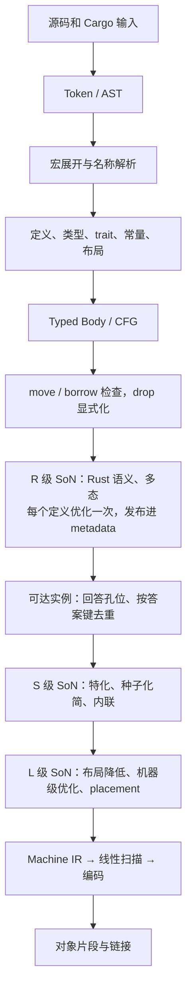

# 设计：带 Rust 语义的 SoN 编译器

状态：**设计草案 draft-0**，2026-11-08。依据见 [research/](../research/README.md)：10 个编译模拟（[walkthroughs](../research/walkthroughs/README.md)，60 条发现已改回本目录）和先例调研（[prior-art](../research/prior-art/README.md)）。字段级定义由 [T02](../plan/m0/t02-shared-contracts.md) 冻结。

## 一句话

rustc 先把 Rust 降到 LLVM IR 的低级形式（每个局部一个 alloca、move 是 memcpy、enum 是 tag/niche 算术、闭包和 drop glue 是独立函数），LLVM 再花大量 pass 把这些结构重建回来。kfrc 不走这条路：SoN 的前两级直接表示 Rust 语义——聚合和 enum 是值，借用是内存分区，drop 和 trait 调用是节点，泛型参数相关的操作是“孔位”——在这一层把大部分优化做完，**最后**才按布局降到机器级节点。

## 编译链

箭头表示依赖，不是全 crate 屏障：不同函数、实例可以同时处于不同阶段（[build/pipeline.md](build/pipeline.md)）。

| 层 | 做什么 | 不做什么 |
|---|---|---|
| Typed Body | 语义：类型、初始化、借用、drop 显式化 | 不复制 rustc 的 MIR 优化 pass |
| R/S 级 SoN | 全部与 Rust 语义有关的优化 | 不出现布局常量（R 级）；类型事实只经答案表读取（S 级起） |
| L 级 SoN | 布局降低与机器级优化 | 不在 Rust 类型上推理 |
| Machine IR | 寄存器、调用约定、栈帧 | 不做 ILP 调度 |

## 核心决定

| 决定 | 消掉的 LLVM 重建工作 | 文件 |
|---|---|---|
| 聚合、enum、宽指针在 R/S 级是 SSA 值 | alloca/memcpy/lifetime（cargo 未优化 IR 的 23.3%）及 SROA/MemCpyOpt/DSE | [ir/values-and-types.md](ir/values-and-types.md) |
| enum 用变体操作表示，编码推迟到 L 级，按 tag 值直接分支 | niche 解码后再折叠（InstCombine/JumpThreading/CVP） | [ir/nodes.md](ir/nodes.md) |
| 借用、`&mut`/`&Freeze` 参数是独立内存分区 | noalias 元数据推断、MemorySSA 查询 | [ir/memory-partitions.md](ir/memory-partitions.md) |
| 事实挂在类型和 `Refine` 节点上，不发 assume | 重复 assume（2.0%） | [ir/values-and-types.md](ir/values-and-types.md) |
| move 是值转发；drop 是节点，`NeedsDrop=false` 时直接消失 | drop glue 薄包装、空 landingpad、nounwind 推断 | [ir/ownership-drop-unwind.md](ir/ownership-drop-unwind.md) |
| 泛型体在 R 级优化一次；实例按答案键去重后再特化 | 每实例重复优化、LocalCopy、ThinLTO 导入体重新简化 | [ir/generics-specialization.md](ir/generics-specialization.md) |
| 单向化简规则 + 变化驱动 worklist + elaboration 式 placement | 同一函数在 pipeline 中反复跑 InstCombine 等 | [ir/optimization-pipeline.md](ir/optimization-pipeline.md) |

## 文件

| 目录/文件 | 内容 |
|---|---|
| [ids.md](ids.md) | 共享 ID、阶段接口、错误分类 |
| [frontend/](frontend/overview.md) | 前端产物与交接（[overview](frontend/overview.md)）、类型表示（[types](frontend/types.md)）、Typed Body（[body](frontend/body.md)） |
| [ir/](ir/levels.md) | 三级 SoN：[levels](ir/levels.md)、[graph](ir/graph.md)、[nodes](ir/nodes.md)、[values-and-types](ir/values-and-types.md)、[memory-partitions](ir/memory-partitions.md)、[ownership-drop-unwind](ir/ownership-drop-unwind.md)、[generics-specialization](ir/generics-specialization.md)、[optimization-pipeline](ir/optimization-pipeline.md)、[verifier](ir/verifier.md)、[semantics](ir/semantics.md) |
| [backend.md](backend.md) | Machine IR、FnAbi、CallLayout、对象片段 |
| [build/](build/pipeline.md) | 任务与产物发布（[pipeline](build/pipeline.md)）、缓存（[cache](build/cache.md)）、Cargo/sysroot（[cargo-sysroot](build/cargo-sysroot.md)） |
| [goals/](goals/compile-time.md) | 四个目标怎么保证：[编译时间](goals/compile-time.md)、[体积](goals/size.md)、[运行速度](goals/runtime.md)；缓存见 [build/cache](build/cache.md) |

## 设计红线

补充[总览红线](../README.md#红线所有文档共用)。

1. **别名事实不强于 rustc 今天使用的事实**：LLVM 参数属性、内联后的作用域，以及默认开启的 MIR GVN 对 `&Freeze` 的推理。更强的事实只采用 Tree Borrows 论文已证明的变换，单独开关，并在 Miri 的 Stacked Borrows 与 Tree Borrows 两种模式下对拍（[rust-aliasing](../research/prior-art/rust-aliasing.md)）。
2. **代码身份不含源位置。** 行号、列号、文件名只进数据表和调试信息，不进函数图的哈希；优化器不能读 `Location` 的内容。
3. **级别单向。** R → S → L 只降不升。
4. **优化不改变 mono 的可观察集合。** mentioned items 在 R 级优化前登记（[generics-specialization](ir/generics-specialization.md#mentioned-items)）。

## 与 rustc 精读笔记的术语差异

[research/rustc/](../research/rustc/README.md) 里的 “ConcreteBody” 写于本设计之前：常量求值仍解释 Body（CheckedBody 加按需代入的泛型参数），不经 SoN；单态化收集的边来自 S 级图，再加 R 级优化前登记的 mentioned 集合。
