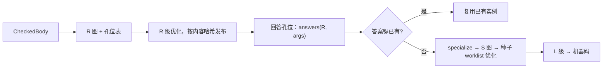

# 泛型：R 级优化一次，按答案特化

## 流程



## 孔位

R 图的 `holes: Vec<Hole>` 记录图对 `Param` 问的每一个问题，按首次出现排序：

```rust
pub enum Hole {
    SizeAlign(TyId), ScalarShape(TyId), ValidRange(TyId),   // ScalarShape 不含符号位，见下
    FieldOffsets(TyId), VariantEncoding(TyId), PassMode(TyId),
    NeedsDrop(TyId), IsFreeze(TyId), IsUnpin(TyId), IsCopy(TyId),
    Resolve { item: DefKey, args: ArgsId },          // TraitCall、drop glue、比较等运算符 trait
    VTable { ty: TyId, trait_ref: TraitRefId },      // 整张 vtable，答案是 VTableKey
    TypeName(TyId), TypeIdOf(TyId), ConstValue { def: DefKey, args: ArgsId },
    PanicStrategy,                                    // 上游 R 图保留 unwind 边，在 S 级裁剪
}
```

**标量答案拆两半（W06）。** 照搬 rustc 的 `BackendRepr` 会把符号位和有效范围带进答案，`Vec<u32>::push` 与 `Vec<i32>::push` 就成了两个键。`ScalarShape` 只含宽度和整数/浮点/指针类别；`ValidRange` 只在 `T` 的值流入比较、switch、cast、算术或调用实参时登记，只经过 Load/Store/Phi/Return 时不登记。比较本身是 `Resolve`（`PartialOrd::gt` 等），所以有符号/无符号/浮点的差别通过递归答案键进入。S/L 级只能经答案表读类型事实；debug 构建下读到未登记的事实就 ICE——这相当于 `-Zmono-dedup` 对 codegen 中 `ty.kind()` 用法的审计，把它变成机械检查。

**闭合孔位。** 非泛型函数和泛型函数中的具体类型也会被问布局（例如 `Option<CrateType>` 的 niche 编码取决于 std `String` 的私有字段）。这些查询同样登记为孔位，只是答案在 R 级就已确定：R 图哈希里的具体类型按与答案相同的规范描述哈希，不按类型名。这样 newtype 和底层类型能共享代码，上游只改私有布局时机器码键也会变。

- 孔位只问**图真正用到、且特化后仍可达的事**。控制孔位（`SizeOf(T)==0` 这类 ZST 分支）先折叠，再收集剩余孔位；被删分支里的问题不进答案向量。指针的 pointee 只在解引用、偏移、按值拷贝时才问布局（`-Zmono-dedup` v4 键的经验：浅描述指针才有去重效果）。
- 布局类孔位（`BackendRepr`/`FieldOffsets`/`VariantEncoding`）在 L 级降低时才被问到；它们也记入孔位表，因为同一 R 图的两个实例只有布局答案也相同时才能共享机器码。

## 答案键

```rust
pub struct SpecializationKey { generic: GraphHash, answers: AnswersHash }
```


三种键，冻结时机不同：

| 键 | 内容 | 何时冻结 | 用途 |
|---|---|---|---|
| **特化身份键** `SpecializationKey` | R 图哈希 + 孔位答案（`Resolve` 的答案取被调者的特化身份键） | 特化**之前** | 查重、共享代码：同键的实例特化结果必然相同 |
| **摘要依赖** | 本实例 S/L 级读过的被调者调用摘要的哈希 | S/L 级结束时 | 只用于缓存失效，不参与查重 |
| **机器码缓存键** | 特化身份键 + 摘要依赖 + 被内联者的特化身份键 + L 级配置 + target | 机器码生成后 | 跨构建复用 |

查重只看特化身份键：同键的两个实例读到的摘要也必然相同，所以不需要摘要参与查重。摘要依赖只决定“上一次构建的机器码还能不能用”。

**环。** 递归调用使特化身份键互相引用。先按 `InstanceKey` 分组，给 SCC 内每个实例一个临时身份（SCC 内序号），对整个 SCC 做 `-Zmono-dedup` 式的类细化不动点，得到最终的特化身份键。SCC 的摘要从 ⊥ 一起迭代（[optimization-pipeline.md](optimization-pipeline.md#调用摘要)），SCC 的机器码缓存键包含整个 SCC 的键集合。
- `Resolve` 的答案是被调实例的**特化身份键**而不是 `InstanceKey`，所以去重是递归的：`Vec<u32>::push` 和 `Vec<i32>::push` 调用的 `RawVec::grow_one` 本身就同键，于是它们也同键。
- `InstanceKey`（[ids.md](../ids.md)）仍然存在，用于符号和可达性；多个 `InstanceKey` 映射到一个答案键，共享一份代码，其余是别名符号。
- 函数指针相等：Rust 不保证不同函数的指针不同（LLVM mergefunc 和链接器 ICF 已经会合并），所以共享代码合法。`#[inline(never)]` 且导出的泛型实例不参与跨 crate 合并（`-Zmono-dedup` v5 的结论）。

## 特化

**不变量**（polymorphization 被移除和 post-mono MIR 尝试失败的教训，[prior-art/rustc-mir-mono.md](../../research/prior-art/rustc-mir-mono.md)）：

- 只有一个 `specialize` 入口，S 图中不出现 `Param`。
- 顺序固定：**先算答案键、查重，再特化，最后内联**。机器码共享的位置与可内联性分开：共享一份机器码不妨碍下游内联它的 S 图（`-Zshare-generics` 的内联损失就是混在一起造成的）。
- S 图是 L 级降低任务内部的临时数据，任务结束即释放；同时存活的 S 图受字节预算限制（rustc post-mono MIR 的 max RSS +7%，最多 +31%）。

`specialize(R 图, answers)`：

1. 复制 R 图（R 图是不可变的已发布产物），**边复制边折叠**：控制孔位先代入，不可达的分支不复制（对应 rustc 的 `mono_reachable`）。
2. 每个孔位节点按答案替换：`SizeOf` → 常量，`TraitCall` → `Call(实例)`，`NeedsDrop=false` 的 `DropValue` → 删除。
3. 把替换过的节点和它们的使用者放进 worklist，跑 R 级规则；新的直接调用按内联策略内联（闭包、trait 方法、`Fn` shim 都在这里消失）。
4. worklist 空了就结束：图中与 `T` 无关的部分在 R 级已是不动点，不会被重新访问。

步骤 3 是 mir-pass-study 指出 MIR 缺的“单态化后的轻量实例级简化”。工作量与 `T` 影响到的区域成正比。种子还包括：曾作为被删除或被内联调用实参的 `StackSlot`（可能可以提升回 SSA），以及以 `IsFreeze`/`IsUnpin` 答案拆出新分区的指针根上的全部内存节点。

## 嵌入实例

迭代器链里大部分实例的参数含调用者私有的闭包类型，只有一个调用点，最后全部被内联（W02：9 个函数进入 LLVM，O3 后剩 1 个）。为它们登记答案键、写摘要和缓存是纯浪费。规则：实参含某个 typeck root 私有的闭包/fn item 类型、且只被该 root 使用的实例是**嵌入实例**，在调用者的 S 级特化里直接展开，不单独登记答案键、不进缓存。被取地址、进 vtable 或多处调用时退回普通实例。

## shim

drop glue、vtable shim、`FnOnce` shim、reify shim 生成后同样按图内容进答案键表。W07 中三个 `drop_in_place<Box<dyn _>>` 屏蔽被调符号后完全相同。

## mentioned items

rustc 的单态化收集器同时收集“used”和“mentioned”两类实例：被优化删掉的调用和常量也要求值，常量求值错误与优化级别无关地报告。kfrc 在 **R 级优化之前**从 R 图登记 mentioned 集合（调用目标、常量、vtable、drop glue），随 R 图一起发布；R 级内联时并入被调者的 mentioned 集合。S 级特化时逐个回答并求值，即使对应节点已被优化删除。

常量求值结果按答案键缓存，但诊断按 `InstanceKey` 用真实类型报告：多个实例共享一个键时，每个实例的错误各自报出。

## 与 metadata 的关系

- 上游 crate 在 metadata 里发布：接口（先发布）、优化后的 R 图 + 孔位表 + mentioned 集合（随后逐体发布）、CheckedBody（只给常量求值用，对应 `mir_for_ctfe`）。
- 发布的 R 图与 panic 策略无关：一律保留 unwind 边，按下游的 `PanicStrategy` 答案在 S 级裁剪（rustc 的 `fn_can_unwind` 读当前会话策略，abort 构建里仍留下上游泛型体的死 cleanup，W04）。
- 非泛型 `#[inline]` 函数同样发布 R 图（它的孔位表为空），下游内联它的图；不再像 rustc 那样在每个用到它的 CGU 里生成 LocalCopy。

## 哪些不由 R 级优化覆盖

- 闭包和迭代器适配器的主体工作：闭包类型是 `Param`，要到 S 级才能内联。R 级仍然能做的是适配器内部与闭包无关的部分（`slice::Iter::next` 的指针比较、`Option` 折叠）。
- 依赖 `T` 布局的循环优化（步长 = `size_of::<T>()`）在 L 级做。

## 可能的扩展（不在首版）

只依赖 `SizeAlign(T)`/`NeedsDrop(T)` 的冷区域（例如 `Vec` 的扩容路径）可以抽成以 size/align 为运行时参数的共享函数，std 的 `RawVecInner` 已经手工这么做。运行时参数只能承载数据类答案，不能有 `Resolve`：Go 的 GC-shape 实例里方法调用只能间接、不能内联，这正是它变慢的原因。自动化前要有 walkthrough 和体积数据。
