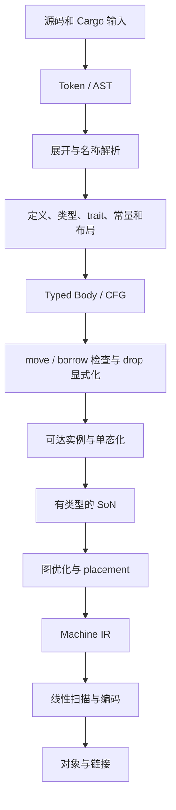

# 自有语义系统与 SoN 编译架构

状态：提议，尚未实施。当前代码基线为 `44c9d80b02ab140d7edf5348b6946d8122d842b6`。本文定义各工作流共用的表示与交付契约；模块负责人不能分别发明不兼容的类型、实例身份或效果模型。

## 1. 架构决策

生产编译链参考并移植 rustc 的成熟语义实现，使用自有数据结构、依赖求值和 SoN 后端。rustc 是实现与测试来源，以及结果对照工具；不通过 `CodegenBackend` 插件保留整个 rustc 前端作为长期架构，也不把 `TyCtxt`、私有 query 或 rustc arena 包装成永久接口。

正式目标代码生成不使用 LLVM 或 Cranelift。继续采用线性扫描寄存器分配，不增加静态 ILP 指令调度器。目标仍包括完整项目正确性、产物质量和编译速度，不能以降低优化质量来证明速度目标。

首个目标平台为 Linux x86_64 System V。Rust edition、MSRV、target features、panic 策略及标准库覆盖由基线清单固定；不能从当前单个整数后端推断完整平台支持。编译器自身的 bootstrap 工具链与它生成目标程序的后端分开记录。

## 2. 当前实现与目标的差距

| 当前源码 | 已存在的能力 | 迁移所需变化 |
|---|---|---|
| [frontend.rs](../../src/frontend.rs) | `parse(source) -> Graph`，解析器同时管理作用域、类型和 SSA | 分离 AST、语义分析与函数体；不再边解析边修改最终 SoN |
| [son.rs](../../src/son.rs) | 整数节点、控制投影、Phi、函数声明索引；预留 memory 输入 | 引入类型、调用身份、真实内存与异常效果，明确验证契约 |
| [optimizer_pipeline.rs](../../src/optimizer_pipeline.rs) | 常量折叠、值编号、代数规则、DCE、受限 LICM | 每条规则携带类型、溢出和效果前提，按新表示逐项迁移 |
| [cfg.rs](../../src/cfg.rs)、[placement.rs](../../src/placement.rs) | CFG、liveness、图 placement | 复用已验证算法，适配新函数体、控制边和异常路径 |
| [x86.rs](../../src/x86.rs)、[regalloc.rs](../../src/regalloc.rs) | 标量虚拟指令、线性扫描、spill | 当前 Load/Store 面向 spill 槽；增加通用地址、宽度、寄存器类别和完整 ABI |
| [elf_reloc.rs](../../src/elf_reloc.rs) | ELF64 文本及 PC32/PLT32 重定位 | 增加数据、只读数据、TLS 等真实项目所需节区和重定位 |
| [parallel_native.rs](../../src/parallel_native.rs)、[pipelined_native.rs](../../src/pipelined_native.rs) | 函数并行及有界分阶段处理 | 调度已完成语义分析的实例，统一 CPU 和内存预算 |
| [native_cache.rs](../../src/native_cache.rs) | 当前图与对象的缓存 | 纳入泛型、布局、调用、target 和语义依赖，不直接复用旧键 |

这些能力为迁移提供基础，但当前没有完整 Rust 内存、类型与语义系统。本文所有新路径均为规划目录，不表示现有代码已迁入。

## 3. 表示与编译路径



图示表达依赖，不代表全 crate 阶段屏障。不同模块、函数或实例可同时处于不同阶段。展开与解析、类型与 trait 求解存在反馈，必须显式记录依赖及循环规则，不能强制成一次线性遍历。

### 3.1 Typed Body 的职责

Typed Body 参考 rustc MIR 的职责，保存局部变量、`Place` 投影、基本块、语句、终结指令、源位置和类型；用于初始化、move、借用约束、drop 和诊断。局部变量身份与语法名字分离，遮蔽产生新身份；字段、解引用、索引等是 Place 投影，不能扁平化成字符串。

函数体先形成合法 CFG，再进行状态分析。分支、短路、match、循环、提前返回和失败路径通过同一个控制流表达处理。已报告的 `if` 表达式修改局部变量后未合并的错编译成为固定回归，不能只在旧解析器中补一个特例。

Typed Body 不复制 rustc 全套优化 pass。它执行语义上必要的降低、检查和 drop 显式化；目标代码优化集中在 SoN。泛型函数体可在未具体化状态完成可行的语义检查，实例化后按具体类型/布局生成 SoN。不能要求所有泛型先单态化才能做借用检查，也不能将泛型阶段的布局假设带入具体实例。

### 3.2 SoN 的职责

SoN 表达可执行计算，包括值、控制、内存和其他可观察效果。优化器可以改变图形状，但必须保留所有执行语义。值 Phi 与内存/效果合并共同对应前驱；未完成循环图在封闭前不能交给优化器或缓存。

参数、常量、计算值带明确类型。整数宽度、符号、溢出模式、浮点行为、指针与地址空间不是由某个后端默认猜测。调用使用稳定的实例/符号引用，并附带已知或保守的效果描述。

第一版采用保守效果链：未知调用、读写内存、volatile、atomic、fence、检查失败和可能 unwind 的操作不能被当成纯值处理。后续别名分区和精细 memory SSA 必须作为单独优化阶段验收。

### 3.3 Machine IR 的职责

Machine IR 承担指令约束、寄存器类别、调用约定、栈帧和机器控制流。placement、liveness、Phi 消除、两地址指令约束及 spill 仍然必需；不做 ILP 调度不会省掉这些工作。

一个 `ObjectFragment` 描述已编码代码/数据、符号、重定位和必要展开信息。对象合并遵守稳定顺序与显式符号身份，不能依赖 worker 完成顺序、HashMap 迭代顺序或进程中的 arena 编号。

## 4. 共享身份与接口契约

以下名称为设计占位，首轮锁定后再实施；不要求这些类型立即成为公开库接口。

| 类型/产物 | 身份范围 | 必须携带的语义 |
|---|---|---|
| `CrateKey` / `DefKey` | 构建图与定义 | 源版本、依赖身份、定义路径和宏卫生；支持确定性命名 |
| `TypeId` / `LayoutId` | 一个已固定的语义快照 | 驻留类型或目标布局；ID 数字自身不能作为持久内容键 |
| `BodyId` / `LocalId` / `BlockId` | 定义与单个函数体 | 变量遮蔽、Place、CFG 前驱/后继关系 |
| `InstanceKey` | 单态实例 | 定义、规范化泛型参数、所选实现及关联依赖 |
| `NodeId` / `ValueRef` | 一个函数图 | 图内身份、结果类型、结果投影；不能跨图裸引用 |
| `TargetSpec` / `FnAbi` | 目标与具体调用 | 宽度、对齐、传参/返回、栈约束、特性、panic/unwind |
| `ArtifactKey` | 产物与缓存 | 输入语义指纹、依赖指纹、目标、配置、实现/schema 版本 |

图可以用稠密 ID 和局部 arena 提高局部性，但所有跨任务引用必须能追溯所属快照。`InstanceKey` 同时用于递归前向声明、符号和缓存，避免三个模块各自维护一套函数编号。

拟采用的阶段接口形态：

```text
analyze_body(def, semantic_snapshot) -> CheckedBody | Diagnostics
instantiate(checked_body, instance, layouts) -> ConcreteBody | Diagnostics
build_son(concrete_body, target_contract) -> VerifiedGraph | LoweringError
optimize(verified_graph, optimization_policy) -> VerifiedGraph
lower_machine(verified_graph, fn_abi) -> MachineFunction | UnsupportedFeature
emit_object(functions, data, symbols, target_contract) -> ObjectArtifact
```

这是行为契约，不是让下游依赖六个可变全局对象。输入快照不可变，函数图由单个任务独占修改；结果验证后发布。实现可内部组合多个算法，但不能把“必须先调用隐藏初始化步骤”交给各调用者记忆。

错误必须区分源程序错误、明确未支持能力、内部不变量失败、外部工具失败。未知语义不能降级成空操作、零值、跳过检查或另一后端。`panic=abort`、overflow-checks 等只能来自已确认配置，不能为后端方便强制覆盖。

## 5. 产物发布与流水线契约

运行时任务状态统一为 `pending → ready → running → validated → published`，失败或取消为 `failed/cancelled`；只有 `published` 表示可供依赖者消费的成功产物。成功产物经验证和原子发布后才可被依赖者消费；失败与取消不能产生看似成功的缓存条目。这是编译器内部状态机，与计划任务的 `planned/in_progress/blocked/verified` 状态分开。

任务至少包括解析模块、展开/解析依赖组、分析函数体、求解所需语义事实、实例化、优化/编码实例和组装对象。递归依赖由语言规则及 SCC 求解，不让 worker 阻塞等待自身；任务数与同时驻留的图内存均有上限。

先做 crate 内函数/实例流水线，再引入跨 crate 提前发布。一个稳定的声明产物可能需要宏展开、impl/coherence、常量、布局或泛型体，不能把“函数签名已解析”直接当作“下游可安全生成机器码”。每个发布产物明确依赖清单和版本。

Cargo jobserver 与内部 worker 共用预算；不叠加 Cargo jobs、优化线程和函数内部线程。单图优化第一版保持单线程，优先在图之间并行。回压和取消必须能传到上游，不能靠队列无限缓存实现吞吐量。

持久缓存从完整对象开始。去掉非语义位置数据不能同时删除宏卫生、定义身份或有语义的 span 信息。编译模式、panic、溢出、目标特性、布局、依赖体、inline 决策和 schema 的变化均需进入适当层的失效规则。

## 6. 迁移目录与切换方式

| 规划目录 | 当前来源 | 迁移方式与完成判据 |
|---|---|---|
| `src/syntax/`、`src/resolve/` | `frontend.rs` 的职责 + rustc 参考 | 新 AST/定义模型贯通后停止扩展旧生产入口 |
| `src/semantics/`、`src/body/` | 新模块，移植成熟语义算法 | 统一类型与 Body；用正反例证明规则，不只验证可解析 |
| `src/instantiate/` | 当前函数元数据 + rustc 实例化参考 | 稳定实例身份，递归与跨 crate 引用不依赖声明顺序 |
| `src/son/` | `son.rs`、优化和分析模块 | 先扩展契约与 verifier，再迁移 pass，避免纯目录搬迁 PR |
| `src/machine/` | `native.rs`、`x86.rs`、`regalloc.rs`、编码 | 保留有效算法；接受有类型图和独立 ABI 描述 |
| `src/object/` | `elf.rs`、`elf_reloc.rs`、`native_object.rs` | 对象/数据/符号统一组织，真实链接验收 |
| `src/build/` | driver、scheduler、pipeline、cache | 语义产物任务图、预算和发布；保留可用取消/顺序逻辑 |

这些是职责目录，不预先拆成大量 crate。先新增一条可显式选择的新链，保留旧子集入口作回归定位。两条链的能力和产物标识必须可区分，禁止根据输入失败自动退回旧链。

每次切换以一个完整功能为单位：输入源码、语义检查、降低、运行、证据全部完成后再迁移调用者。旧实现只有在没有生产调用者、对应测试已迁移且新实现通过出口时删除。旧缓存使用不同 schema/namespace，不能被新链读取。

## 7. rustc 移植约定

已查看的本地参考树标记 Rust 1.94.1，commit 为 `acea19e8bf9280a1bc7fa606d3b7670d0fa7d734`；它是本地研究基线，不宣称为可直接引用的上游发布 commit。正式移植版本尚未选择，应由冻结任务记录可获取的 upstream commit、源码校验和、许可与目标项目 MSRV。

参考范围包括 `rustc_parse`、`rustc_resolve`、类型/trait 推导、`rustc_borrowck`、`rustc_mir_transform` 的 drop elaboration、`rustc_monomorphize`，以及 `rustc_codegen_ssa` 的 MIR 降低和 ABI 规则。每次移植记录原始文件/commit、依赖闭包、采用的不变量、主动改变的表示及移入的回归样本。

高度耦合模块先做语义实验：如果实现一个最小 trait 约束或借用例子必须携带大半 `TyCtxt`/query/arena，先重划本地数据模型或缩小功能闭包，不用永久 rustc wrapper 掩盖适配成本。所有移植保留必要来源与许可。

## 8. 阶段出口与回退

| 出口 | 通过条件 | 不通过时的处理 |
|---|---|---|
| M0→M1 | 源码/工具链固定，接口表无冲突，差分原始证据可重放 | 停止并行实现共享类型，先补冻结与契约 |
| M1→M2 | 新 AST/Body/SoN/native 纵向链跑通，分支赋值等控制流回归正确 | 对同类降低路径做静态排查；不继续堆语法 |
| M2→M3 | 类型、布局、内存、ABI 各自有完整运行对照 | 保持保守效果模型，关闭未验收的优化规则 |
| M3→M4 | trait、borrow、move/drop 的声明范围有正反例与执行验证 | 记录缺失能力，暂不宣称 sysroot/完整 Rust 兼容 |
| M4→M5 | Cargo/metadata/sysroot 路径及所有目标对象生产者可追踪 | 保留明确标记的 bootstrap；不记入 full-native 覆盖 |
| M5→M6 | 原生真实项目功能等价，没有静默 fallback | 先补正确性，性能数字不替代功能验收 |

回退是恢复上一条已验收的实现或关闭新优化，不是改变程序语义。计划不承诺数倍加速；编译速度与产物质量需在同等配置、同一环境中分别测量。

后端详细工作包见 [SoN 与 native 后端迁移](workstreams/son-backend.md)。
