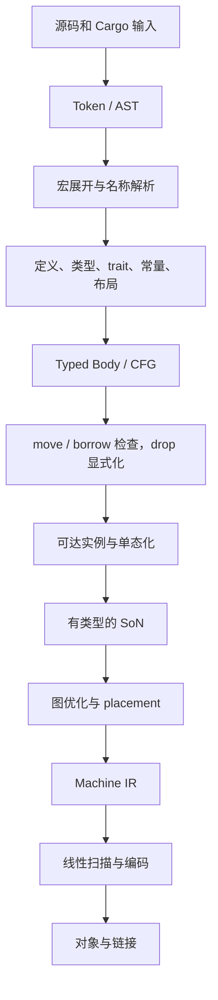

# 架构

目标架构的共享契约。各角色不能各自定义不兼容的类型、实例身份或效果模型；改动共享契约先更新这里。决策背景见 [迁移计划总览](../README.md)。

| 文件 | 内容 |
|---|---|
| [representations.md](representations.md) | Typed Body、SoN、Machine IR、对象片段各自负责什么，verifier 查什么 |
| [identities.md](identities.md) | 共享 ID、阶段接口、错误分类 |
| [frontend.md](frontend.md) | 前端各阶段产物及其保证，Body → SoN 交接规则 |
| [build-pipeline.md](build-pipeline.md) | 编译器内部任务、产物发布、失败恢复、CPU/内存预算 |
| [cache.md](cache.md) | 缓存分层、键、失效测试 |
| [cargo-sysroot.md](cargo-sysroot.md) | Cargo 协议、host/target、sysroot、来源标签 |
| [code-layout.md](code-layout.md) | 规划目录和新旧链切换方式 |

## 编译链

箭头表示依赖，不是全 crate 屏障：不同模块、函数、实例可以同时处于不同阶段。展开与解析、类型与 trait 求解之间有反馈，要显式记录依赖和循环规则。

## 分层原则

- **Typed Body** 做语义：类型、初始化、借用、drop。只做语义必需的降低，不复制 rustc 的 MIR 优化 pass。
- **SoN** 做优化：所有目标代码优化集中在这里。
- **Machine IR** 做机器约束：寄存器、调用约定、栈帧。
- 泛型函数体在参数环境下完成类型和借用检查；实例化后再按具体类型/布局生成 SoN。
