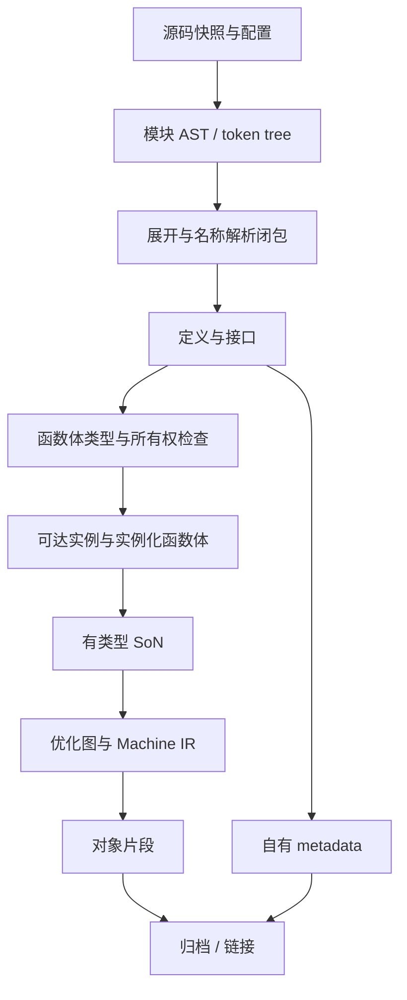

# 构建流水线

编译器内部如何调度任务和发布产物。目标是按语义依赖发布产物，而不是在 rustc 外再包一层。

## 现有实现

| 文件 | 已有能力 | 迁移处理 |
|---|---|---|
| [scheduler.rs](../../../src/scheduler.rs) | 固定 DAG、有界并发、失败后停止派发、按登记顺序返回 | 扩展为动态依赖发现、语义循环处理、统一预算 |
| [pipelined_native.rs](../../../src/pipelined_native.rs) | 解析 → 优化/placement → native 三阶段，有界队列，稳定输出顺序 | 保留背压、错误定位、取消；输入改为有版本的语义产物 |
| [native_batch.rs](../../../src/native_batch.rs) | 文件批处理、输出路径检查 | 成为旧 `.kfr` 路径；新链按模块/定义/实例调度 |
| [parallel_native.rs](../../../src/parallel_native.rs) | 函数级并行 | 接收就绪的实例图，不再自行扩张线程数 |
| [native_cache.rs](../../../src/native_cache.rs) | 图对象缓存、校验、错误降级为 miss | 保留读写完整性机制，重新定义键，见 [cache.md](cache.md) |

先在现有目录上加明确模块，不先造通用分布式任务框架。

## 产物依赖

| 就绪产物 | 包含 | 消费规则 |
|---|---|---|
| 模块解析结果 | 源码摘要、edition、AST、span/token tree | 不代表宏展开或名称解析完成 |
| 定义接口 | 定义身份、类型约束、可见性、layout/impl/常量依赖 | “看到函数签名”不等于下游可以生成机器码 |
| 已检查函数体 | Typed Body、类型、move/borrow/drop 结果、依赖清单 | 未支持语义在此拒绝 |
| 单态实例 | 规范化实例身份、布局/ABI、可达调用/静态数据/glue | 递归调用可先声明符号，定义完成后才发布 |
| 对象片段 | 目标、节/符号/重定位、配置、输入指纹 | 链接只接收已验证片段 |
| crate metadata | schema、编译器/语言版本、目标、定义与依赖指纹、泛型体 | 自有格式；不匹配则拒绝或重编 |

依赖可以后续补充进图，但已发布的成功产物不可修改。循环三类处理：名字/递归定义先声明后检查；语义依赖的 SCC 作为一组求解和发布；trait 递归按移植算法的 canonical goal 和归纳/余归纳规则。未完成任务挂到等待集合并归还执行资源。

## 任务状态与发布

`pending → ready → running → validated → published`，失败或取消为 `failed` / `cancelled`。只有 `published` 能被依赖者消费。（这与[项目任务状态](../roadmap/README.md#任务状态)是两回事。）

- 任务读取不可变输入，独占自己的 arena 和图，验证后一次性发布结果和依赖摘要。
- 持久产物：写临时文件 → 校验格式和哈希 → 原子重命名 → 再写成功清单。
- “接口已就绪”和“对象已就绪”分开记录，带构建世代和依赖身份；旧构建的标记不能解锁新消费者。

## 失败与取消

- 首版 fail-fast：停止派发，唤醒所有等待者，运行中任务在安全点取消，关闭队列并 join 线程。
- 已发布且依赖完整的独立缓存项可以保留；不完整的输出不能升级为可链接结果。
- 以后的 `--keep-going` 只取消受影响的依赖闭包，并证明不会永久等待。
- 进程崩溃、链接失败、上游被杀、缓存损坏、磁盘写满、父进程退出都有明确结果和清理策略。超时算失败。

## CPU 与内存预算

- Cargo jobserver 与内部 worker 共用一份预算，不让 `cargo -j × 阶段 worker × 函数 worker` 相乘。从 Cargo 继承 jobserver 时，额外并行先取 token，等待外部产物时释放；没有 jobserver 时用显式本机预算。
- 队列同时限制任务数和估算/实测字节；超大单图走专用准入，不无限积压其他图。
- 首版单图内部串行变换，并行发生在图之间，避免大量细任务的调度开销。

## 确定性

符号、实例身份、输出顺序和诊断顺序不依赖线程完成顺序或 HashMap 遍历。jobs=1/2/4 和扰动调度得到相同的归一化 IR 和相同的对象字节。格式里若有时间戳等非语义字段，先统一编码规则，而不是比对时临时过滤。
