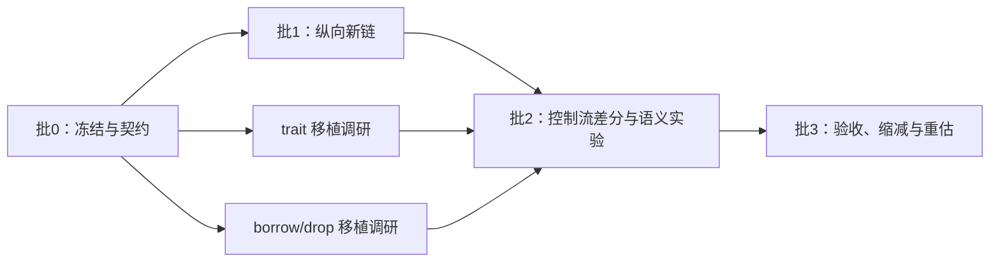

# 首轮：十个工作日的架构验证时间盒

状态：`planned`。本文件可用于分批派工，任务状态以[任务清单](../tasks.md)为准。十个工作日是投入上限和重估点，不保证完成 M1，更不保证完成 M3。首轮目标是证明自有表示能贯通，并尽早测出高耦合语义的移植成本。

开始前阅读[阶段出口](../milestones.md)、[共享架构](../architecture.md)、[来源地图](../rustc-source-map.md)和[验证契约](../validation.md)。任何首轮任务不得放宽这些文档中的语义、来源或验收要求。

## 首轮的范围

交付一条显式选择的新链：普通 Rust 源文件 → 自有 AST/定义与最小类型检查 → Typed Body → SoN → 现有 native 基础 → ELF → 真实 x86 执行。先覆盖已固定的标量、函数调用与有状态控制流闭包；模块、引用、trait 等能力按下述准入单独增加。

保留旧 `.kfr` 入口供回归定位，两条链产物和缓存隔离。不得以调用旧前端或 rustc 来补齐新链失败的输入。目标平台、edition、溢出/panic 策略和最小 driver 形式由批 0 冻结；初始不具备标准库时，可用明确标识的 C ABI 驱动，不因此声称已支持普通 `std` 程序。

首轮不承诺完整宏系统、完整 trait solver/borrowck、core/alloc/std、Cargo 整仓兼容、跨 crate metadata 提前发布、持久语义缓存、全工作区 daemon 或新的优化算法。trait 与 borrow/drop 的两个实验是移植可行性证据，不自动成为生产能力。

## 五个职责流与修改所有权

五个职责流不要求五个 agent 始终同时运行；实际并发遵循可用席位、依赖和验证资源。集成人不与工作者同时修改其所有文件；共享契约变更先由集成人收敛，再交还模块负责人。

| 职责流 | 修改范围 | 消费的输入 | 首轮输出 |
|---|---|---|---|
| A：语法与名字 | 计划中的 `syntax/`、`resolve/`，相应来源记录与 fixture | 固定语法范围、ID/span/AST 契约 | 能交给 B 的 AST/定义快照及正反例；不生成 SoN |
| B：类型与 Body | `semantics/`、`body/`，两项语义实验 | A 的产物、共享类型/Place/CFG 契约 | CheckedBody 最小闭包、控制流状态与类型错误；trait/borrow 实验依赖报告 |
| C：SoN 与效果 | SoN builder/verifier 和必要适配 | B 的确定性 Body、目标语义 | VerifiedGraph、Phi/控制/效果不变量、失效样例 |
| D：机器码与对象 | 目标 ABI、Machine IR、现有编码和对象接入 | C 的已验证图、FnAbi/符号契约 | 可链接对象、ABI driver、真实执行结果；不修改前端以规避后端错误 |
| E：构建与证据 | driver、任务执行入口、差分 harness、manifest | 固定源码/工具链、各模块产物和执行命令 | 可重放的构建/执行/拒绝对拍、来源清单、批次报告 |

`TypeId/DefKey/InstanceKey/Place/CheckedBody/VerifiedGraph/FnAbi` 的含义由架构契约统一；具体命名在批 0 决定。单个任务不能自创平行版本，也不为方便链接在各目录复制数据定义。

## 批次图与时间预算



| 预算 | 批次 | 启动门槛 | 结束输出 |
|---|---|---|---|
| 第 1–2 工作日 | 批 0 | clean 候选和参考材料可取得 | 冻结清单、接口版本、原始错误重放、派工卡 |
| 第 3–5 工作日 | 批 1 | 批 0 出口通过 | 一个最小完整新链，明确剩余 unsupported |
| 第 6–8 工作日 | 批 2 | 对应 Body/SoN 契约稳定；批 1 可执行 | 控制流差分结果，两项语义移植实验与成本清单 |
| 第 9–10 工作日 | 批 3 | 已完成部分具有可复现产物 | 阶段判定、未完成项、后续 PR 和重新估算 |

本轮使用任务清单的统一编号：

| 批次 | 任务 |
|---|---|
| 批 0 | [T00 版本/来源冻结](../tasks.md#t00)、[T01 clean 复现](../tasks.md#t01)、[T02 共享契约](../tasks.md#t02)、[T03 差分 harness](../tasks.md#t03) |
| 批 1 | [T04 syntax](../tasks.md#t04)、[T05 names](../tasks.md#t05)、[T06 Typed Body](../tasks.md#t06)、[T07 SoN verifier](../tasks.md#t07)、[T08 标量 ABI/机器接口](../tasks.md#t08)、[T09 Body→SoN](../tasks.md#t09)、[T10 新 driver 串行闭环](../tasks.md#t10) |
| 批 2 | [T11 任务/资源准入](../tasks.md#t11)、[T12 trait 实验](../tasks.md#t12)、[T13 borrow/drop 实验](../tasks.md#t13)，并扩充 T03/T09 的控制流差分 |
| 批 3 | [T14 M1 收敛出口](../tasks.md#t14)，按完整出口决定是否 verified |

日期到达不会自动满足门槛。前批未通过时，后批只做不依赖未定契约的材料核对、fixture 准备和来源分析；禁止先猜接口并行写大量代码。剩余时间不足时采用本文件末尾的缩减顺序。

## 批 0：冻结、错误与共享契约

集成人先冻结 clean commit、正式参考源码、oracle 二进制、初始 target/edition/cfg 和工具链构建模式。已有脏工作区和旧二进制只作历史证据，不并入候选。来源选择遵守[来源地图](../rustc-source-map.md)，未固定正式来源时先暂停依赖其内部细节的大规模移植。

可并行派工：A/B 阅读实际移植闭包及上游回归；C/D 梳理现有图和 ABI 对新表示的要求；E 建立输入/命令/产物指纹与真实执行 runner。每项输出先是来源与接口约束，不先创建相互不兼容的实现。

本批必须收敛：

- 输入语言最小集合：整数/布尔、绑定/赋值、函数、if/loop 与返回；具体边界类型和普通模块是否纳入首轮由清单逐项确认。
- 共享身份、类型、Body/CFG、控制流合并、目标 ABI、错误分类、产物来源及状态的最小契约。
- 首个成功 fixture、预期拒绝 fixture，以及[已知 if 错编译](../validation.md)的 clean 重放。若冻结构建不能复现，保留结果并追踪来源差异，不能改输入凑出同一数字。
- 每条链明确调用关系，列出会调用的外部程序；目标函数对象必须由候选生成。

出口是可供下一执行者直接使用的派工包：输入 revisions、配置、公共类型定义或精确草案、fixture 清单、原始结果位置、每个角色可改文件。只有接口字段已明确，依赖它的实现任务才切到 `in_progress`。

## 批 1：最小纵向新链

优先沿一条完整路径推进，不一次实现大量语法。

| 顺序 | 可派工任务契约 | 完成证据 |
|---|---|---|
| 1 | A 接收固定源码并输出 AST/定义快照，B 接收同一产物生成标量 Typed Body | 源位置、遮蔽身份、类型和 CFG 可检查；无效输入在正确层拒绝 |
| 2 | C 接收 CheckedBody，统一处理分支/循环状态，构建并验证 SoN | Body 与图转储可对应；错误 Phi/控制依赖被 verifier 拒绝 |
| 3 | D 用既有机器码基础接入新图和 ABI，E 接通显式新入口 | 生成对象可链接；真实执行与 oracle 对拍 |
| 4 | 在完整链存在后扩展到调用/递归及首轮固定控制流集合 | 每项新增能力有跨完整链用例；来源和 unsupported 清单同步 |

A/B/C/D 的实现依赖顺序不能用占位返回值伪装完成。接口稳定后，C/D 可以用固定人工 IR fixture 独立调试；这类结果标为层内验证，不计入源程序新链覆盖。E 可从批 0 开始并行完善 runner，但不能写镜像实现的测试来代替源行为对拍。

首轮调度先保留串行参考执行，再接最小函数级有界并行。只有序列化执行正确、输入产物不可变、符号身份稳定后才允许并行准入；不在这一步实现动态 trait 调度和跨 crate 通知。

批 1 出口：至少一个成功和一个拒绝用例穿过新公共入口；分支状态回归运行正确；日志能够区分新链和旧链；任何未接入能力显式拒绝。如果只到 AST/Body/图转储，状态仍为部分完成，不能称为 M1 通过。

## 批 2：控制流差分与高耦合迁移实验

三条工作可并行，但各自必须满足输入门槛；B 的两个实验若由不同工作者实现，应使用隔离实验目录或不同文件所有权。

| 工作 | 输入和范围 | 输出与退出条件 |
|---|---|---|
| 状态控制流差分 | 批 1 完整链；if/match/短路/loop 中实际已支持的组合 | 保存 seeds、原始输出和最小反例；每种已支持组合有真实机器证据；未实现语法单列 |
| trait 实验 | 固定上游来源、TypeId/约束模型；选择一个有约束泛型和对应不满足约束反例 | 列出 canonical goal/参数环境/推导事务的必要依赖；最小闭包行为与 oracle 一致；记录未覆盖的 coherence/关联类型/递归规则 |
| borrow/drop 实验 | Place/CFG/初始化事实契约；选择 move、借用冲突和分支析构的小型自包含用例 | 有效/无效分类与 oracle 一致；drop 路径显式可检查；如果尚不能执行，标成分析原型，不能计入运行正确性 |

两个实验首先回答“我们的数据模型能否表达这组语义、需要迁移哪些依赖”。不允许以移入大半 `TyCtxt` 或完整 query runtime 的方式绕过问题。没有足够成熟的内存和析构执行链时，可以交付事实提取/约束求解原型及缺口；其状态不能提升成 M3 能力已验证。

T12/T13 的 `verified` 仅表示该实验任务按其范围取得证据和成本结论，不表示 trait/borrow 的生产迁移或 M3 已完成。若实验约定要求的观测没有取得，任务仍未 verified；不能用一份缺口报告替代其明确的成功条件。

遇到同一类错编译，按[验证契约](../validation.md)停止重复压测，先静态排查相邻路径并批量修复。新语法扩展暂停，允许其他职责流继续不依赖该错误的材料整理。实验结论必须同时记录已采用和明确未采用的上游规则。

## 批 3：集成验收和下一轮决策

集成人选择冻结候选，由 E 在干净环境重放；负责实现的人提供命令和产物，不能只口头确认。验收包括：源码/二进制一致性、显式新入口、真实 x86 正例、拒绝例、控制流回归、必要的 verifier、串行/并行结果一致性，以及来源记录和已知缺口。

不为本轮编写完整 Rust 性能结论。允许记录阶段时间和峰值内存以定位结构成本，但不据此宣称 ripgrep/Cargo 加速。只有已有完整新链的样例才计入运行覆盖；人工 IR、混合 bootstrap、分析原型分别计数。

批 3 输出一份仓库内交接记录，至少包含：

1. 接受的源码 commit、构建命令、oracle/候选哈希、执行环境与 target。
2. `planned/in_progress/blocked/verified` 任务表及证据链接；部分任务写清未完成部分，不以一个总百分比代替。
3. 公共契约版本、主动偏离来源实现的点、移植来源与许可记录。
4. 新链已支持/明确拒绝/尚未验证集合，以及 clean 重放的已知失败。
5. trait 与 borrow/drop 实验的依赖成本、尚缺的模型能力和是否进入正式迁移。
6. 下一组可独立验收 PR、前置条件、负责人和需要的验证资源。

M1 出口未完全满足时如实保留未完成状态；可记录某个纵向样例已验证，但不跳过[阶段表](../milestones.md)的完整要求。时间盒结束后按实际依赖和缺陷密度重估，不用新增 agent 数量换算剩余工期。

## 首批实现 PR 的切分

| 顺序 | 范围 | 必须交付 | 后续依赖 |
|---|---|---|---|
| PR 1：冻结基线与差分入口 | manifest、固定来源、成功/拒绝/已知失败 fixture、真实执行 harness | clean 输入到结果的重放；失败期望显式登记，不能把 known-fail 算通过 | 所有后续实现 PR |
| PR 2：最小生产链 | 批 0 契约及最小 AST→Body→SoN→ELF 纵向闭包 | 正例和拒绝例实际经过新入口；已知分支问题的最小路径正确 | 控制流扩展与后续语义迁移 |
| PR 3：控制流闭包与必要并行 | 已支持条件/循环/调用的组合，串行参考及有界并行准入 | 状态合并、真实执行、输出确定性；不顺带加入新缓存层 | M1 出口及 M2 |
| 后续独立 PR：语义实验转生产 | trait 或 borrow/drop 的一个闭包，分别提交 | 实验成本报告、明确范围与对应完整验证；只在依赖具备后接入 | M3 对应能力 |

PR 2 若仍过大，可先拆出可独立验证的公共表示/verifier，但不能把纯目录移动、空类型或 `todo!()` 接口算成迁移完成。每个 PR 的标题和说明围绕最终可观察行为。实验报告可以单独提交，不能把尚未通过行为验证的实验代码默认为生产路径。

## 时间不足时的缩减顺序

先延后更宽的语法/模块覆盖、第二个语义实验的执行接入、并行调度扩展、任何缓存和微优化。保留来源冻结、公共契约、一个最小新链、已知错编译类回归以及可重放证据。若连最小新链也无法完成，交付准确的阻塞依赖与已验证层，停止用更多半成品扩大范围。

不能削减真实执行、无效输入检查、来源记录、显式 unsupported 或已发现错误的同类排查。缺失这些内容的任务仍是 `in_progress` 或 `blocked`，不得标为 `verified`。

## 可直接用于派工的任务卡

```text
任务：引用任务清单中的唯一 ID 和本批次。
状态：planned；前置任务 verified 后才能进入 in_progress。
输入：源码 revision、契约版本、来源 commit、目标/配置、fixture 集合。
所有权：列出唯一可修改目录/文件；共享类型变更交由集成人协调。
行为：描述输入到产物/诊断的一个闭包，列明不支持范围。
证据：真实执行或拒绝对拍命令、原始日志、产物哈希、来源与许可记录。
停止条件：新同类错误、共享契约未定、来源不可验证或需要越界修改。
交接：变更摘要、结果与限制、证据位置、后续依赖；不提交无证据的完成声明。
```

派工时执行者必须知道自己不是唯一修改者，不能撤销他人工作。批次交接由集成人更新任务状态和契约；没有依据的“看起来可用”不是下一批启动条件。
