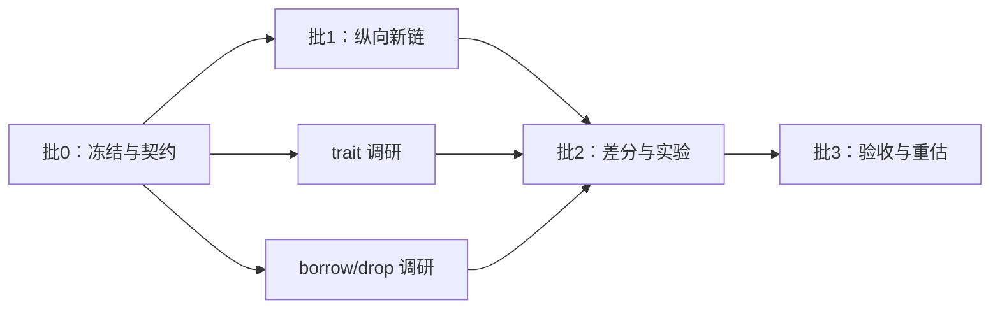

# 首轮：十个工作日的架构验证时间盒

**目标：** 证明自有表示能从源码贯通到真实执行，并尽早测出 trait、借用/drop 这类高耦合语义的移植成本。

十个工作日是投入上限和重估点，不保证完成 M1。任务定义和状态以 [roadmap/](../roadmap/README.md) 为准，本目录只讲排期和交接。

| 文件 | 内容 |
|---|---|
| [batch-0-freeze.md](batch-0-freeze.md) | 第 1–2 天：冻结输入、复现错误、定契约 |
| [batch-1-vertical-chain.md](batch-1-vertical-chain.md) | 第 3–5 天：最小纵向新链 |
| [batch-2-experiments.md](batch-2-experiments.md) | 第 6–8 天：控制流差分与两项语义实验 |
| [batch-3-acceptance.md](batch-3-acceptance.md) | 第 9–10 天：验收、交接与重估 |
| [prs.md](prs.md) | 首批实现 PR 的切分 |

## 范围

一条显式选择的新链：普通 `.rs` → 自有 AST/定义与最小类型检查 → Typed Body → SoN → 现有 native 基础 → ELF → 真实 x86 执行。先覆盖标量、函数调用和有状态控制流；模块、引用、trait 按批 0 的清单逐项纳入。

- 旧 `.kfr` 入口保留用于回归定位，两条链的产物和缓存隔离。
- 还没有标准库时，可以用明确标识的 C ABI driver。

**不在首轮：** 完整宏系统、完整 trait solver/borrowck、core/alloc/std、Cargo 整仓、跨 crate metadata 提前发布、持久语义缓存、全工作区 daemon、新优化算法。T12/T13 两个实验只是可行性证据，不成为生产能力。

## 排期



| 天 | 批次 | 任务 | 启动门槛 | 产出 |
|---|---|---|---|---|
| 1–2 | 批 0 | T00 T01 T02 T03 | 干净候选和参考材料可取得 | 冻结清单、接口版本、错误重放、派工卡 |
| 3–5 | 批 1 | T04–T10 | 批 0 出口通过 | 最小完整新链，剩余 unsupported 清单 |
| 6–8 | 批 2 | T11 T12 T13，扩充 T03/T09 差分 | Body/SoN 契约稳定，批 1 可执行 | 控制流差分结果、两份实验报告 |
| 9–10 | 批 3 | T14 | 已完成部分有可复现产物 | 阶段判定、未完成项、后续 PR、重估 |

日期到了不代表门槛满足。前一批没通过时，后一批只做材料核对、fixture 准备和来源分析，不先猜接口写大量代码。

## 职责与文件所有权

| 角色 | 首轮修改范围 | 输入 | 首轮输出 |
|---|---|---|---|
| A 语法与名字 | `syntax/`、`resolve/`、来源记录、fixture | 固定语法范围、ID/span/AST 契约 | AST/定义快照与正反例 |
| B 类型与 Body | `semantics/`、`body/`、两项实验 | A 的产物、类型/Place/CFG 契约 | 最小 CheckedBody、类型错误；实验依赖报告 |
| C SoN 与效果 | SoN builder/verifier | B 的 Body、目标语义 | VerifiedGraph、Phi/控制/效果不变量 |
| D 机器码与对象 | ABI、Machine IR、编码、对象接入 | C 的图、FnAbi/符号契约 | 可链接对象、ABI driver、真实执行结果 |
| E 构建与证据 | driver、执行入口、差分 harness、manifest | 冻结源码/工具链、各模块产物 | 可重放的对拍、来源清单、批次报告 |

- 五个角色不要求五个 agent 同时运行，实际并发看依赖和验证资源。
- 共享契约（TypeId/DefKey/InstanceKey/Place/CheckedBody/VerifiedGraph/FnAbi）由集成人统一，不在各目录复制定义。
- 集成人不和工作者同时改同一文件；执行者知道自己不是唯一修改者，不撤销他人工作。

## 时间不足时的缩减顺序

先延后：更宽的语法/模块覆盖 → 第二个实验的执行接入 → 并行调度扩展 → 缓存和微优化。

始终保留：来源冻结、公共契约、一条最小新链、已知错编译的回归、可重放证据、真实执行、无效输入检查、显式 unsupported、同类错误排查。

连最小新链都完成不了时，交付准确的阻塞依赖和已验证的层，不再扩大半成品范围。

## 派工卡模板

```text
任务：roadmap 中的唯一 ID + 批次
输入：源码 revision、契约版本、来源 commit、目标/配置、fixture 集合
所有权：唯一可修改的目录/文件；共享类型变更交给集成人
行为：一个“输入 → 产物/诊断”的闭包，列出不支持范围
证据：真实执行或拒绝对拍命令、原始日志、产物哈希、来源与许可
停止条件：新的同类错误、共享契约未定、来源不可验证、需要越界修改
交接：变更摘要、结果与限制、证据位置、后续依赖
```
