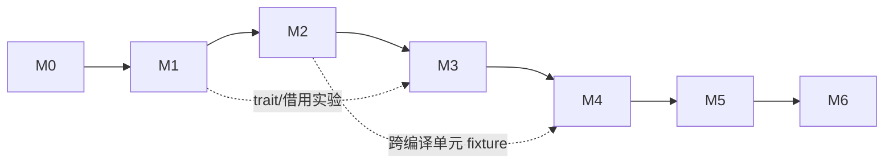
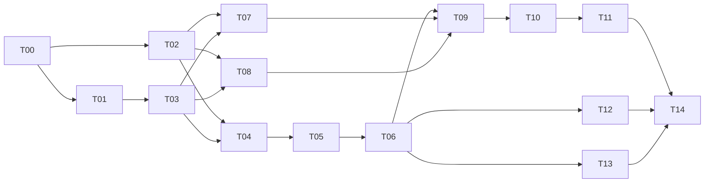

# 路线图：阶段与任务

每个阶段一个文件，包含该阶段的目标、出口条件和全部任务。任务编号 T00–T42 是唯一的派工编号。

| 阶段 | 文件 | 任务 |
|---|---|---|
| M0 基线 | [m0-baseline.md](m0-baseline.md) | T00–T03 |
| M1 纵向新链 | [m1-vertical-chain.md](m1-vertical-chain.md) | T04–T14 |
| M2 类型/内存/ABI | [m2-types-memory-abi.md](m2-types-memory-abi.md) | T15–T20 |
| M3 Rust 语义 | [m3-semantics.md](m3-semantics.md) | T21–T27 |
| M4 Cargo/sysroot | [m4-cargo-sysroot.md](m4-cargo-sysroot.md) | T28–T34 |
| M5 真实项目 | [m5-real-projects.md](m5-real-projects.md) | T35–T37 |
| M6 质量与性能 | [m6-quality-performance.md](m6-quality-performance.md) | T38–T42 |

## 阶段依赖

每个阶段只在前一阶段出口通过后正式开始；接口调研、测试向量准备可以提前。

## 首轮关键链（M0–M1）

T09 先用 T03 runner + T08 机器入口拿到真实执行证据，T10 再接公共 CLI，二者不互相等待。T12、T13 可与后端任务并行。

## 负责角色

| 角色 | 范围 |
|---|---|
| A | 语法、名称解析、宏 |
| B | 类型、trait、Typed Body、借用/drop、const、单态化、sysroot 语义 |
| C | SoN、效果、优化 |
| D | ABI、Machine IR、寄存器分配、对象文件、runtime 机制 |
| E | driver、调度、缓存、Cargo、验证 runner |
| I | 集成：共享契约、阶段出口、状态维护 |

每个任务只有一个最终负责角色。角色不等于同时在线的 agent 数。

## 任务状态

`planned → in_progress → verified`，受阻时为 `blocked` 并写明缺口。

- 硬依赖全部 `verified` 后才能进入 `in_progress`；开始时记录负责人、输入 revision 和范围。
- `verified` 需要 [验证协议](../validation/README.md) 要求的原始证据；测试数、代码量不算进度。
- T00–T14 可以直接拆成实现 PR。T15 起是阶段包，开始前先拆成 `Txx.a`、`Txx.b` 等子项并更新本目录。
- 层内验证（如只跑图 verifier）不能替代阶段出口的真实执行。
- 契约先于实现冻结。发现契约不足时先改契约和受影响任务。

这是项目进度状态；编译器内部任务的运行状态机见 [architecture/build-pipeline.md](../architecture/build-pipeline.md)。
