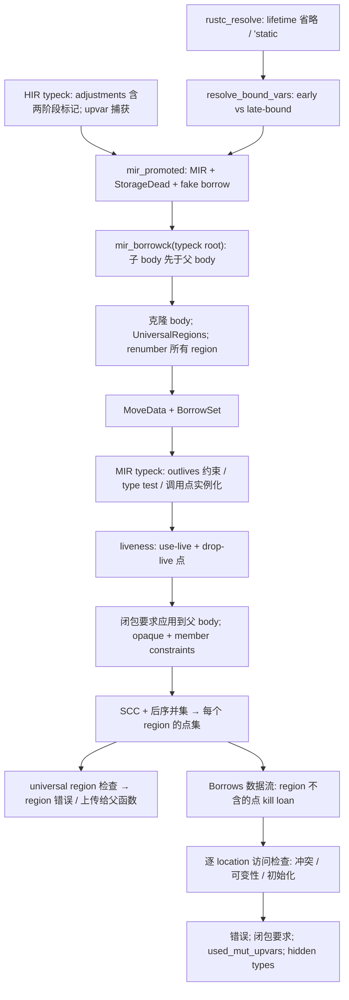

# 借用检查与生命周期（rustc 1.94.1 精读）

基于 rustc 1.94.1（commit `e408947bfd200af42db322daf0fadfe7e26d3bd1`）源码。链接固定到该 commit，行号已核对；标“推断”的内容未在源码中直接验证。初始化/move path/drop 展开见 [../ownership/](../ownership/README.md)，本目录只在交界处引用。

## 索引

| 文件 | 内容 |
|---|---|
| [flow.md](flow.md) | query 入口、typeck root 调度、每个 body 的收集/检查两半、MIR 语句到访问种类的映射、NLL vs Polonius |
| [regions.md](regions.md) | RegionVid 编号、MIR typeck 产生的 outlives 约束、方差、SCC、region 值传播、universal region 检查、placeholder |
| [liveness.md](liveness.md) | region 何时 live：use-live 回溯、drop-live 与 dropck、boring locals 剪枝 |
| [loans.md](loans.md) | BorrowSet、loan 的 gen/kill、NLL 作用域终点、冲突矩阵、`places_conflict`、出口检查、可变性检查 |
| [two-phase-and-reborrow.md](two-phase-and-reborrow.md) | 两阶段借用的来源与激活、`is_active`；重借用的 region 约束与 loan 语义 |
| [lifetimes-origin.md](lifetimes-origin.md) | 省略规则、early/late-bound、`'static`、隐含界、外部 region |
| [closures.md](closures.md) | 捕获分析（2021 精确捕获）、捕获在 MIR 中的形状、闭包 region 要求上传 |
| [opaques.md](opaques.md) | `impl Trait` hidden type、member constraints、与调度的耦合 |
| [test-cases.md](test-cases.md) | `tests/ui` 代表用例与对应规则、建议的首轮子集 |

## 一页概览

要点：

- **借用检查 = region 推导 + loan 数据流 + 访问检查。** loan 何时失效完全由 region 值（点集）决定：从借用点出发，第一个不在 `region(loan)` 里的点 kill 该 loan（[loans.md](loans.md)）。
- region 值 = liveness 点 ∪ 经 outlives 约束流入的点/`end('a)`；约束传播不看位置（NLL）。1.94 默认 `-Zpolonius` 为 Off，stable 行为就是 NLL（[flow.md](flow.md#4-nll-还是-polonius已核实)）。
- HIR typeck 不决定任何 region；它决定 adjustments（autoref、重借用、两阶段标记）和闭包捕获，借用检查只消费这些决定。
- 闭包和父函数作为一个 typeck root 一起检查；闭包对外部 region 的要求上传给父函数，在闭包创建点变成约束。

## kfrc 最小闭包与移植建议

### [T13](../../roadmap/m1-vertical-chain.md#t13)（首轮实验：字段读、可变借用/重借用、分支部分 move、提前返回、一次析构）

需要的事实（Typed Body 层产出）：

1. 类型中每个引用位置的 **region 槽**；`Rvalue::Ref` 等价物带 `BorrowKind`（Shared / Mut / 两阶段 / fake）和自己的 region 槽。
2. 显式 adjustments：`Deref`、`Borrow(kind, two_phase)`；两阶段临时“一次赋值、至多一次使用”。
3. 结构化 Place（`Field`、`Deref`、`Downcast`、`Index`/常量索引）、整局部 def 与投影 use 的区分、`StorageDead` 等价的作用域结束点、`Drop` 点。
4. 函数签名的 lifetime 参数（省略结果 + early/late 标记）。若实验函数不收发引用，可只有 `'static` 和 `fn_body` 两个 universal region。

需要的算法（全部可不依赖 TyCtxt 实现）：

- universal region 建表（`'static`、签名参数、`fn_body`）和已知关系（自反、`'static: r`、`r: fn_body`、where 子句、引用嵌套的隐含界）。
- 约束生成：赋值子类型（带方差）、`add_reborrow_constraint`、调用点 late-bound 实例化 + 实参子类型 + 调用点 live、签名等式（`Locations::All`）。
- use-live 回溯与“出现即 live”；SCC + 后序并集；universal region 检查。
- `BorrowSet`、`Borrows`（含 out-of-scope 预计算、整局部赋值/`StorageDead` kill）、`places_conflict`、访问矩阵、出口检查、两阶段 `is_active`（需要支配树）。
- move/初始化检查和 drop 显式化按 [../ownership/](../ownership/README.md)。

可推迟（首轮遇到就明确报错）：闭包、`impl Trait`、`for<'a>` 高阶类型（placeholder/universe）、泛型 `T: 'a` type test、trait 投影的规范化与隐含界、`#[may_dangle]`/真 dropck、用户 region 标注之外的 `AscribeUserType` 细节、Polonius。

### [T16](../../roadmap/m2-types-memory-abi.md#t16)（M2 安全子集）

在 T13 上增加：含 lifetime 参数的 struct/enum（需要 **ADT 方差推导**和 `inferred_outlives_of` 等价物）、slice/数组投影（`Index` 冲突偏向、常量索引、`Subslice`）、可变性检查（`is_mutable` 规则）、drop-live 近似（字段递归 + 有 `Drop` impl 的类型参数全部 live）、返回引用的函数和 E0106/E0515/E0597/E0499/E0502/E0503/E0505/E0506 分类。

### [T22](../../roadmap/m3-semantics.md#t22)（M3 完整语义）

按依赖分子包：(1) 真 dropck（依赖 [T21](../../roadmap/m3-semantics.md#t21) 的 trait 查询与 `Drop` impl 表）；(2) 泛型 type test 与上传；(3) 闭包三步（见 [closures.md](closures.md#5-对-kfrc-的含义)）；(4) placeholder/universe；(5) opaque 与 member constraints（在 M4 之前）。

### 与 TyCtxt/query 的耦合点（rustc 中借用检查实际调用的外部事实）

| rustc 来源 | 用途 | kfrc 替代 |
|---|---|---|
| `mir_promoted`、`nested_bodies_within`、`closure_captures` | 输入 body、root 分组、upvar | 自有 Typed Body 与 typeck root 产物 |
| `fn_sig`、`generics_of`/identity args、`resolve_bound_vars` | universal region、调用点实例化 | 签名收集产物（T05/T06） |
| `predicates_of`、`param_env`、`explicit_outlives_bounds` | where 子句约束、已知关系 | 签名收集产物 |
| `ImpliedOutlivesBounds`、`push_outlives_components`、`assumed_wf_types` | 隐含界 | 首轮自写的 WF + 分量拆分；投影部分等 T21 |
| `variances_of`、`inferred_outlives_of` | ADT 子类型、隐含界 | 新增的方差/outlives 推导（不在当前计划中） |
| `DropckOutlives`、`adt_dtorck_constraint`、`has_dtor` | drop-live、`places_conflict` 的 Drop 访问 | 近似 → T22 真实现 |
| `InferCtxt` 的 region 变量、universe、type-op canonical 查询 | 约束收集管道 | 借用检查自有 RegionVid arena；无需 canonical 查询 |
| `rustc_mir_dataflow`（`MoveData`、初始化分析、框架） | 初始化状态、drop-live 起点 | ownership 主题的自有数据流 |
| `type_of(opaque)` ← `mir_borrowck` | hidden type | 推迟；之后需任务图新边 |

### 粗略工作量与风险（推断）

- rustc 规模参考（行数，含注释）：loan/冲突核心 1.9k；region 求解 3.2k；MIR typeck + liveness + universal regions 6.7k（大量是 trait/规范化管道）；opaque 1.0k；Polonius 2.7k（不移植）；诊断 14.5k（不移植，只产出错误码 + 主 span）；`upvar.rs` + `expr_use_visitor.rs` 4.5k。
- 估算 kfrc 自写：T13 约 3–4k 行（不含 ownership 部分），T16 再加 2–3k，T22 的闭包 2–3k、opaque 1–1.5k。
- 主要风险：Typed Body 缺 region 槽/adjustment/两阶段结构导致 T06 返工；方差与隐含界被低估；dropck 和 opaque 把借用检查拉进 trait 求解和任务图依赖。

## 会改变计划的发现

1. **T13 的“loan 事实”离不开 region 推导。** loan 的失效点由 region 点集决定，所以首轮就要一个最小 NLL（region 槽、约束生成、use-liveness、SCC 求解）。建议把 T13 拆成 T13a（move/初始化/drop CFG）与 T13b（loan + region），或明确扩大 T13 预算。
2. **Typed Body 契约（T02/T06）需补字段**：region 槽、带两阶段标记的借用 adjustment、BorrowKind（含 fake/unique）、作用域结束点、结构化投影（`Downcast`/常量索引/`Subslice`）。[representations.md](../../architecture/representations.md#typed-body) 目前只写了“借用”。
3. **签名级生命周期是解析/签名阶段的产物**（省略、early/late-bound、隐含界），首轮只要函数收发引用就需要，应归入 T05/T06 的交付物。
4. **ADT 方差与推断 outlives** 是含 lifetime 参数的 struct 的前置条件，当前 T15/T16 未列出。
5. **liveness 依赖 ownership 的初始化数据流，drop-live 依赖 dropck（trait）**：T16 用近似，T22 的真 dropck 依赖 T21；初始化分析必须先于 region 推导完成。
6. **调度与缓存单位是 typeck root**（函数 + 全部嵌套闭包，子先父后）；闭包捕获分析在 typeck 且随 edition 变化。T22 的“closure 捕获”跨 typeck 与借用检查，宜拆三步。
7. **`impl Trait` 让借用检查结果成为调用者的类型输入**；任务图需新增“调用者依赖被调者借用检查”的边，member constraints 需在 M4（std）之前完成，在此之前显式拒绝。
8. **oracle 是 NLL**：Polonius 默认关闭，problem case #3 被拒绝；差分比较“接受/拒绝 + 错误码 + 主 span”，不移植 14.5k 行诊断代码。
