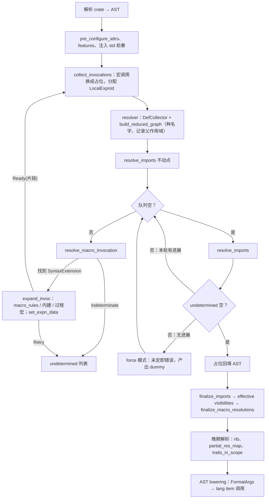

# 宏展开、hygiene、名称解析、过程宏与内建宏

基于 rustc 1.94.1（`e408947b`）源码。覆盖 `rustc_expand`、`rustc_resolve`、`rustc_span/hygiene.rs`、`rustc_builtin_macros`、`rustc_ast_lowering/src/format.rs`。对应计划任务：[T04](../../roadmap/m1-vertical-chain.md#t04)、[T05](../../roadmap/m1-vertical-chain.md#t05)、[T23](../../roadmap/m3-semantics.md#t23)、[T30](../../roadmap/m4-cargo-sysroot.md#t30)；模块责任见 [rustc-map.md](../../sources/rustc-map.md)，前端产物见 [frontend.md](../../architecture/frontend.md)。

## 文件

| 文件 | 内容 |
|---|---|
| [expansion-loop.md](expansion-loop.md) | `fully_expand_fragment` 工作队列、不定重试与 force、属性/derive 顺序、cfg 剥离、急切展开 |
| [macro-rules.md](macro-rules.md) | 定义编译、fragment 与 edition、NFA 匹配、转录与不可见分组、文本作用域、`#[macro_export]`/`#[macro_use]` |
| [hygiene.md](hygiene.md) | `SyntaxContext`/`ExpnData`/`Transparency`、`apply_mark`、两种规范化、各类名字的比较规则、`$crate` |
| [name-resolution.md](name-resolution.md) | 早/晚两阶段、DefCollector 与 DefKey、模块图、`visit_scopes` 顺序、Determinacy、前奏、可见性 |
| [imports.md](imports.md) | 导入不动点、glob 推送、遮蔽表、确定性谓词、受限遮蔽与歧义、finalize |
| [proc-macros.md](proc-macros.md) | 宏 dylib 加载、server 方法集、TokenStream 转换、span 卫生、host 方案对比 |
| [builtin-macros.md](builtin-macros.md) | 内建宏注册与绑定、`format_args!` 到 HIR 的降低、derive、assert/panic、ripgrep 用量统计 |
| [test-cases.md](test-cases.md) | tests/ui 代表性用例与 kfrc 自有回归建议 |

## 概览：展开与解析是同一个不动点

要点：

- 每产出一个片段，先把其中的定义和导入种进模块图，再继续展开；宏路径、导入的早期解析是推测性的，返回 `Ok / Determined 失败 / Undetermined` 三态（[name-resolution.md](name-resolution.md)）。
- 正确性靠两条规则而不是回溯：来自 glob 和宏展开的名字不能遮蔽外层名字（冲突即歧义错误，[imports.md](imports.md)）；展开结束后用 finalize 模式重解析每个宏路径和导入，结果变化即报错。
- hygiene 是 span 的一部分：标识符相等 = 名字 + `SyntaxContext`；模块级名字按 `normalize_to_macros_2_0` 比较（`macro_rules` 下不卫生），局部变量和标签按 `normalize_to_macro_rules` 比较（卫生）（[hygiene.md](hygiene.md)）。
- 内建宏不是特殊名字：库里有 `#[rustc_builtin_macro]` 宏项，解析照常进行，编译宏时换展开器（[builtin-macros.md](builtin-macros.md)）。

## 会改变 kfrc 计划的发现

1. **ripgrep 的构建闭包不需要过程宏。** ripgrep 15.2.0 在 Linux 默认 features 下的 normal/build 依赖里没有 proc-macro crate，`serde_derive` 只是 dev-dependency；所需 derive 全是内建的（Debug/Clone/PartialEq/Eq/Copy/Default/Hash/PartialOrd/Ord）。T30 应拆成“build script”（ripgrep 闭包里有 10 个：ripgrep、anyhow、crossbeam-deque/epoch/utils、libc、serde、serde_core、serde_json、zmij）和“过程宏协议”（Cargo 和 ripgrep 测试需要）两项，后者移出 ripgrep 关键路径。
2. **hello world 就需要 macro_rules 引擎。** `println!`、`vec!`、`assert_eq!`、`write!` 是 std/core 里的普通宏，经 `std::prelude::rust_20xx::*` 解析（1.94 注入的 `extern crate std;` 不带 `#[macro_use]`）。只要编译冻结的 std，T23 的宏引擎、前奏解析、`$crate` 和跨 crate hygiene 就都在关键路径上，不能用内建 `println!` 替代。
3. **`format_args!` 的降低与冻结的 core 版本绑定。** 1.94 生成 `unsafe { Arguments::new(b"<字节码模板>", &args) }`，参数经两层 `super let` 建立；只有字面量时用 `Arguments::from_str`。字节码编码必须与冻结 core 的解码一致，Typed Body 必须支持 `super let` 的临时值生命周期。建议原样移植 `expand_format_args`，并在 T31 冻结时对照 core 源码。
4. **T04 的 Span 要带 `SyntaxContext`。** token 和 AST 标识符的身份是 `(Symbol, ctxt)`；宏产出的 token 保留定义处位置、换 ctxt。M1 无宏时 ctxt 恒为根，但字段和比较规则现在就要定型，否则 T23 要改遍 resolver。
5. **T05 的 resolver 必须是可增量驱动的三态求值器。** 模块表键 `(Macros20 规范化 ident, ns, '_'序号)`，值保存非 glob/glob/待定单项导入；接口区分推测与 finalize。一次性全局扫描式的 T05 到 T23 会被推倒重来。
6. **DefKey 不携带卫生，disambiguator 按创建顺序分配。** [identities.md](../../architecture/identities.md) 要求 DefKey 带宏卫生，rustc 并不如此；“完成顺序不改变 DefKey”在 rustc 里靠确定的展开顺序成立。kfrc 若并行展开，需要用展开树位置定序；建议 T02 明确取舍。
7. **自有 metadata 要导出宏和卫生表。** 外部 `macro_rules` 以 token 存储、使用时按定义 crate 的 edition 重新编译；fragment 种类按 matcher token 的 span edition 决定；下游展开 std 宏依赖序列化的 `ExpnData`/`SyntaxContextData`。ripgrep 闭包同时含 2015（encoding_rs_io）、2018、2021、2024 四个 edition。
8. **差分对拍依赖 rustc 的 pretty printer。** 无消息 `assert!` 的 panic 文本是 `pprust::expr_to_string(cond)`，`stringify!` 是 `pprust::tts_to_string`。要让失败路径输出与 rustc 一致，需要兼容的表达式/token 打印器。另外 ripgrep 闭包里 zmij 在 x86_64 上用 `asm!("/*{0}*/", inout(reg) x)`，内联汇编（至少空模板 + 寄存器约束）也在 ripgrep 关键路径上。

## kfrc 最小闭包与移植建议

### T04：token tree 与 span 预留

- `Span { lo, hi, ctxt }`（或 `SpanId` + 侧表），`ctxt` 是驻留的 `SyntaxContextId`；根 ctxt 为 0。
- token tree 保留：分隔符种类含 `Invisible(origin)`；`Spacing`（`Alone`/`Joint`/`JointHidden`；前两者对过程宏可见，`JointHidden` 对过程宏表现为非 joint）；raw 标识符标记；字面量保持原始文本（kind、symbol、suffix），后解析数值。
- AST 节点保留来源 token 区间，供 `macro_rules` 代入、derive/属性宏输入和 `stringify!`。
- 解析器入口按 fragment 种类可调用（expr/ty/pat/pat_param/stmt/item/block/path/vis/meta/literal/lifetime/ident），并在这些位置接受不可见分组。
- 卫生表结构（`ExpnData` arena、`SyntaxContextData` 驻留含两种规范化）可以在 T04 定义、T23 才填充。

### T05：能与展开迭代的名称解析

- 模块图、`NameResolution`、`Decl`（Def/Import）、`ParentScope`、`ScopeSet`/`Scope` 遍历按 rustc 形状实现；查找返回三态。
- “种名字”按片段进行（DefCollector + 归约图），模块记录未展开调用集合；M1 时集合恒空，但待定的单项导入和 glob 仍会产生 Undetermined，三态接口从 M1 起就需要。
- 导入不动点 + glob 推送 + 歧义记录在 T05 就做（无宏也需要：glob 环、重复定义、导入环）。
- late 阶段 rib 规则（块内项先于局部变量、局部变量按 macro_rules 规范化比较、标签 rib）照搬。
- finalize 复核作为内部不变量检查保留。

### T23：macro_rules 最小可用子集

必须：全部稳定 fragment（含 `pat_param`、`expr_2021` 与按 edition 推断）、`* + ?` 与分隔符、嵌套重复、黑盒提交语义、`local ambiguity`、未绑定 `$x` 透传（宏生成宏）、`$crate`、递归限制 128、文本作用域与 `#[macro_use] mod`、`#[macro_export]`、`use` 导入宏、`#[macro_use] extern crate`、`local_inner_macros`、受限遮蔽歧义、跨 crate 宏加载。

推断也需要（library 不在本 checkout，T31 冻结时用 [builtin-macros.md](builtin-macros.md) 中的扫描方法核实）：`macro` 2.0 项与 `Opaque` 透明度（core 的部分宏以 `pub macro` 声明，内建宏声明也用它）、`#[rustc_macro_transparency]`、`allow_internal_unstable`、可能的元变量表达式。

可推迟：follow-set 与 `check_meta_variables` 检查（只拒绝非法定义，冻结输入合法；在实现前列为已知缺口）、未使用宏/规则 lint、`macro_rules` 的 attr/derive 规则、`trace_macros`/`log_syntax`。

### 内建宏清单（按目标排序）

| 优先级 | 宏 | 依据 |
|---|---|---|
| std/ripgrep 必需 | `format_args!`、`format_args_nl!`、`const_format_args!`（推断 core 的 panic 宏使用）、`panic!` 分派（`std_panic`/`core_panic`）、`unreachable!` 分派、`assert!`、`concat!`、`stringify!`、`line!`/`column!`/`file!`/`module_path!`、`cfg!`、`env!`/`option_env!`、`include!`/`include_str!`/`include_bytes!`、`compile_error!`、`asm!` | ripgrep 扫描计数（[builtin-macros.md](builtin-macros.md)）+ std 宏展开链 |
| 必需 derive | `Clone`（含 Copy 联动）、`Copy`、`Debug`、`Default`、`PartialEq`、`Eq`、`PartialOrd`、`Ord`、`Hash` | ripgrep 扫描 |
| 必需属性 | `derive`、`cfg`/`cfg_attr`；`#[test]` 仅 ripgrep 测试需要；`global_allocator` 只在 musl 64 位目标需要（jemalloc） | 同上 |
| 推断 std 需要 | `global_asm!`、`naked_asm!`、`concat_bytes!`、`cfg_select!`、`derive_const`、`ConstParamTy`、`CoercePointee`、`alloc_error_handler` | 内建表 + core/std 惯用法，T31 核实 |
| 可推迟 | `trace_macros!`、`log_syntax!`、`autodiff`、`contracts`、`eii`、`pattern_type!`、`iter!`、`cfg_accessible`、`From` derive、`bench`/`test_case` | 不稳定或目标项目未用 |

### T30：过程宏 host 协议

推荐 B+C：kfrc 自带 `proc_macro` 库与自有 bridge，宏在进程外 server 中执行；兼容 rustc 1.94.1 bridge 加载 stock dylib（方案 A）只作明确标记的过渡。细节与缓存键见 [proc-macros.md](proc-macros.md)。

## 工作量与风险（估计）

| 块 | 估计 | 主要风险 |
|---|---|---|
| span ctxt + 卫生表 + 比较规则 | 1–2 人周 | 晚加会改动 resolver 全部查表点 |
| macro_rules 引擎（匹配、转录、fragment 解析、edition） | 3–5 人周 | 黑盒解析与 kfrc 解析器的错误恢复耦合；不可见分组在各语法位置的接受规则 |
| 展开循环 + 早期解析 + 导入不动点 + 歧义 + finalize | 6–10 人周（其中 T05 部分 3–4） | 确定性谓词细节多、兼容 hack 多；并行化时的定序 |
| 内建宏（含 format_args 降低、9 个 derive、assert/panic、asm 解析） | 4–6 人周 | 与冻结 core 的内部 API（`Arguments::new` 字节码、`debug_struct_field*_finish`）绑定 |
| 兼容 pretty printer（assert/stringify） | 1–2 人周 | 空格与括号规则细碎，只能对拍 |
| 宏与卫生的 metadata 导出 | 2–3 人周（属 T29） | 跨 crate ctxt 编码与 edition 保真 |
| 过程宏 B+C | 6–10 人周（需先能编 syn/serde_derive） | host/target 分离、动态库产物、缓存键完整性 |

性能风险：serde、regex-syntax、encoding_rs 一类宏密集 crate 的展开时间；rustc 用 ctxt 缓存（`Marker`）、`Cow` 复用解析器、MacroRules 作用域路径压缩来控制成本，kfrc 需要同等手段。
