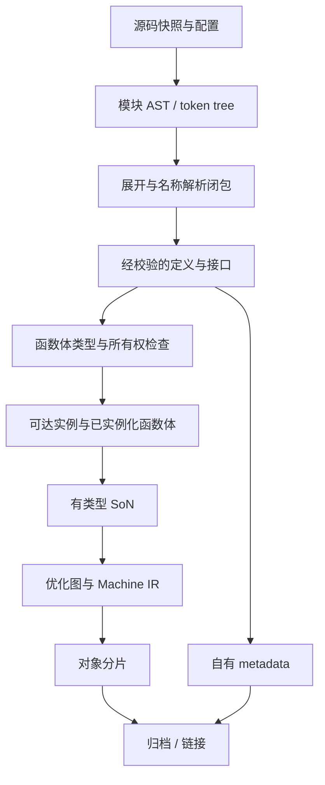

# 构建、产物与流水线迁移

状态：计划，尚未实现。与[架构](../architecture.md)、[验证契约](../validation.md)一起使用。目标是让自有编译器按语义依赖发布产物；不是调用 rustc 的另一层包装器。

## 现状与迁移位置

| 当前实现 | 已有能力 | 迁移处理 |
|---|---|---|
| [scheduler.rs](../../../src/scheduler.rs) | 固定 DAG、有界并发、失败后停止派发、按登记顺序返回 | 保留小型任务执行语义；增加动态依赖发现、语义循环处理和统一预算前，不宣称已能调度完整编译器 |
| [pipelined_native.rs](../../../src/pipelined_native.rs) | 多输入的解析、优化/placement、native 三阶段；有界队列和稳定输出顺序 | 保留背压、错误定位与取消经验，阶段输入改为有版本的语义产物 |
| [native_batch.rs](../../../src/native_batch.rs) | 输入文件批处理、输出路径检查 | 成为旧 `.kfr` 路径；生产路径按模块/定义/实例调度，不将文件等同于 crate |
| [parallel_native.rs](../../../src/parallel_native.rs) | 独立函数编译并行 | 接收已经就绪的实例图；不再独立扩张线程数 |
| [native_cache.rs](../../../src/native_cache.rs) | 当前 native 图对象缓存、校验与错误降级为 miss | 保留读写完整性机制；重新定义键及依赖，旧键不能沿用到完整 Rust |
| [cargo.rs](../../../src/cargo.rs)、[main.rs](../../../src/main.rs) | 历史 rustc wrapper；native Cargo 显式拒绝 | 新 driver 实现 Cargo 编译器协议；旧 wrapper 单独作为历史入口，不能计入新链覆盖 |

迁移首批沿现有目录增加明确模块，目录名称由架构工作包统一确定；不先创建通用分布式任务框架。本文的产物类型与事件名是拟议契约，不是现存命令或公开接口。

## 产物与任务依赖

不同模块和函数可同时处于不同节点；箭头表示必须满足的语义依赖，不是全 crate 屏障。实现必须允许后续发现的依赖补充进图，但不能修改已经发布的成功产物。

| 就绪产物 | 必须包含 | 消费规则 |
|---|---|---|
| 模块解析结果 | 源码摘要、edition、AST、span/token tree | 不能据此认定宏展开或名称解析完成 |
| 定义接口 | 定义身份、类型约束、可见性、必要的 layout/impl/常量依赖 | 消费者声明实际依赖；“已看到函数签名”不等于能检查全部下游代码 |
| 已检查函数体 | Typed Body、类型、move/borrow/drop 结果、语义依赖清单 | 未支持的语义必须拒绝；不能进入 codegen 再猜测 |
| 单态实例 | 规范化的实例身份、布局/ABI、可达调用/静态数据/胶水依赖 | 递归调用允许先声明符号，定义完成后才发布可链接产物 |
| 对象分片 | 目标、节区/符号/重定位、编译配置和输入指纹 | 链接只能接收已验证分片，不能用临时文件存在作为成功信号 |
| crate metadata | schema、编译器/语言版本、目标、定义与依赖指纹、所需泛型体 | 使用自有格式，不宣称官方 rustc metadata 兼容；不匹配则拒绝或重编 |

循环分三类处理：名字/递归定义先建立声明，再检查函数体；已知语义依赖图的 SCC 作为一组求解和发布；trait 递归必须沿用移植算法的 canonical goal、归纳/余归纳与溢出规则，不能把所有循环都当作普通 DAG 错误或一律接受。未完成任务通过等待集合挂起，归还执行资源；禁止 worker 阻塞等待它自己或同一预算下不可运行的任务。

## 不可变发布与失败恢复

每项运行时任务状态为 `pending → ready → running → validated → published`；`failed/cancelled` 不进入 published。状态名称与[共享架构](../architecture.md)一致，转换事件和恢复规则在实现前由 build 与 semantics 所有者共同固定；这不是工作计划条目的进度状态。

任务读取不可变输入，独占本地 arena 和图；验证通过后一次性发布结果及依赖摘要。持久产物写临时文件、完成格式/哈希检查，再原子重命名；只在完整产物可读取后发布成功清单。跨进程的“接口已就绪”和“对象已就绪”分开记录，包含同一构建世代和依赖身份；旧构建留下的 ready 标记不能解锁新消费者。

第一版采用 fail-fast：停止新任务，唤醒所有等待者，运行任务在安全检查点取消，关闭队列并 join 线程。已发布且其依赖全部完成的独立缓存项可以保留；不完整、来源未验证的项目输出不得升级为可链接结果。`--keep-going` 后续实现时，只取消受影响依赖闭包，并证明不存在永久等待。进程崩溃、链接失败、上游被杀、缓存损坏、磁盘写满、父进程退出均有明确结果与清理策略。

## CPU、内存与确定性

统一预算覆盖 Cargo 进程槽位和编译器内部 worker。从 Cargo 继承 jobserver 时，明确当前进程已有的执行权和额外 token；额外并行工作先获取 token，等待外部产物时释放不再使用的 token。没有 jobserver 时使用显式本机预算。不要把 `Cargo -j × stage workers × function workers` 相乘。

队列同时约束任务数量与预估/实测占用字节，独占单图允许超出单项软额度时使用专用准入，不能因此无限积压其他图。按未完成依赖和内存高水位施加背压。首版每个实例图内部顺序变换，不拆成逐节点任务；优先减少大量细任务调度的固定成本。

符号、实例身份、输出排序和诊断排序不能依赖线程完成顺序或 HashMap 遍历。jobs=1/2/4 及扰动调度得到相同归一化 IR、相同对象字节；若格式含非语义时间戳，必须先统一编码规则，而不是靠比对时随意过滤差异。取消不允许把诊断遗漏当成成功。

## 缓存与增量

先只接入完整语义键的对象缓存，再逐层缓存已检查函数体/实例/优化图。第一阶段可以偏保守失效，不能为命中率省略语义依赖。

键至少包含：编译器与 schema 版本、源语义和宏卫生身份、edition/cfg/features、目标/CPU 特性、类型与布局/ABI、panic/overflow/优化/调试策略、所需依赖接口与泛型体、静态常量和内联体摘要。环境、文件及工具输入若不可完整跟踪，则该任务不可跨构建复用；不得把执行过一次的 build script/proc macro 结果默认视为纯函数。

分别验证注释变化、函数体变化、公开签名变化、trait impl 变化、泛型体变化、宏/hygiene 变化、target-feature 变化和编译器升级。span 中的纯诊断坐标可以与语义摘要分离，宏卫生和定义身份不可以删除。每个 hit 都要能说明命中了哪些依赖版本，旧对象来源可追溯。

## Cargo、host/target 与 sysroot

新 driver 首先完成 `-vV`、`--print`、crate 类型、`--emit`、`--extern`、cfg、目标、dep-info、诊断/产物 JSON 等实际 Cargo 调用契约。采用编译器入口模式，若保留 wrapper 模式只设置一层并测试嵌套情形；不能复用当前同时设置两类 wrapper 的假设。未知且影响语义的参数应拒绝，不能静默忽略。

Cargo 是外部构建编排器，自有 driver 负责每次编译请求。跨 crate 提前发布若需要 Cargo 修改，必须单独列出协议和兼容开关，不能假设普通 Cargo 会理解自有的按条目通知。M4 先保证标准 Cargo 调用闭环，跨 crate 细化调度后置。

host 图包含构建脚本、过程宏及其依赖；target 图包含程序、依赖和 sysroot。分别记录 target triple、编译器生产者、特性和产物身份。原生的过程宏 runner/协议需要实现和验证；官方 rustc 编译的 proc-macro 动态库不能假设直接可加载。早期混合 bootstrap 可以使用明确隔离的 host 工具链或桥接进程，但必须标为混合路径。

sysroot 按 `core → alloc → std` 推进，同时处理 compiler-builtins、panic runtime、分配器、平台库和内建机制。Rust ABI 不作为跨任意版本混链的稳定承诺。C/C++ 库可由其原生工具链编译，但必须在最终清单中单列；目标 Rust 依赖不能偷偷用 LLVM 生成对象填补缺失功能。

每次构建输出来源清单：模块/对象、源码版本、编译器哈希、host/target、配置、缓存命中来源与链接归属。至少区分“混合 bootstrap”“目标 Rust 依赖全 native”“host 工具也全 native”；这些是不同里程碑。

## 分阶段工作与退出条件

| 工作包 | 阶段与前置 | 交付 | 出口证据 |
|---|---|---|---|
| 构建清单与事件 | M0；固定工具链与源码 | 任务时间线、产物来源、失败记录 | 旧二进制/脏源码无法冒充冻结候选 |
| crate 内任务图 | M1；自有 ID/Typed Body/SoN 接口 | 函数或语义组级就绪队列、串行参考执行 | 1/2/4 jobs 同结果；循环依赖无死锁 |
| 资源和取消 | M1–M2；任务图 | token、字节背压、错误传播 | 故障注入后无悬挂、泄漏或伪成功 |
| 语义对象缓存 | M2–M3；完整依赖摘要 | 新键、版本化条目、命中解释 | 键变异失效；hit/miss/禁用输出一致 |
| crate 产物与 Cargo | M4；实例化、布局和调用闭包 | 自有 metadata/rlib、driver 协议 | 两个真实依赖 crate、再构建、错误恢复通过 |
| host/target 与 sysroot | M4–M5；语义闭包 | 来源清单、宏/构建脚本、core/alloc/std | 全 native 范围明确，缺失链路不以混链掩盖 |
| 跨 crate 提前发布 | M4–M6；接口依赖可声明 | 可选通知协议、对象等待、世代校验 | 任意消费前对象身份正确，关闭时行为一致 |
| 性能调度 | M6；M5 正确性出口 | 关键路径/内存优化及缓存收益 | [验证契约](../validation.md)规定的真实项目证据 |

恢复策略以选择旧入口或关闭新调度/缓存开关实现，测试产物目录和缓存 namespace 隔离。旧入口只保留旧能力，不能作为新能力的静默 fallback。跨 crate 提前发布无稳定收益时保留 crate 内任务图，不以增加复杂度维持计划进度。
