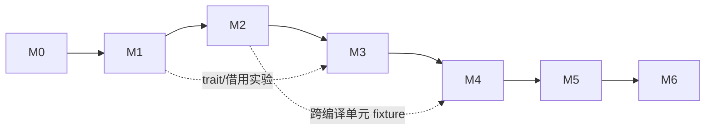
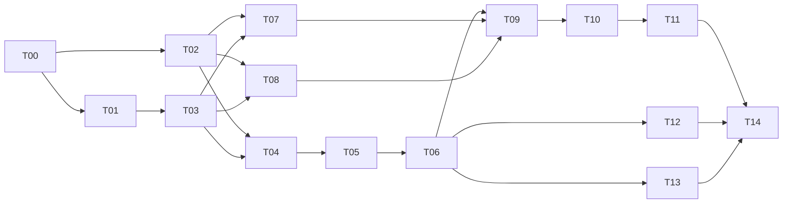

# 计划：阶段与任务

每个阶段一个文件，包含该阶段的目标、出口条件和全部任务。任务编号 T00–T42 是唯一的派工编号。设计见 [design/](../design/README.md)。

| 阶段 | 文件 | 任务 |
|---|---|---|
| M0 基线 | [m0-baseline.md](m0-baseline.md)，细化 [m0/](m0/) | T00–T03 |
| M1 纵向新链 | [m1-vertical-chain.md](m1-vertical-chain.md)，细化 [m1/](m1/) | T04–T14 |
| M2 类型/内存/ABI | [m2-types-memory-abi.md](m2-types-memory-abi.md) | T15–T20 |
| M3 Rust 语义 | [m3-semantics.md](m3-semantics.md) | T21–T27 |
| M4 Cargo/sysroot | [m4-cargo-sysroot.md](m4-cargo-sysroot.md) | T28–T34 |
| M5 真实项目 | [m5-real-projects.md](m5-real-projects.md) | T35–T37 |
| M6 质量与性能 | [m6-quality-performance.md](m6-quality-performance.md) | T38–T42 |

## 阶段依赖

每个阶段只在前一阶段出口通过后正式开始；接口调研、测试向量准备可以提前。

## 首轮关键链（M0–M1）

T09 先用 T03 runner + T08 机器入口拿到真实执行证据，T10 再接公共 CLI，二者不互相等待。T12、T13 可与后端任务并行。

## 负责角色

| 角色 | 范围 |
|---|---|
| A | 语法、名称解析、宏 |
| B | 类型、trait、Typed Body、借用/drop、const、单态化、sysroot 语义 |
| C | SoN、效果、优化 |
| D | ABI、Machine IR、寄存器分配、对象文件、runtime 机制 |
| E | driver、调度、缓存、Cargo、验证 runner |
| I | 集成：共享契约、阶段出口、状态维护 |

每个任务只有一个最终负责角色。角色不等于同时在线的 agent 数。

## 任务状态

`planned → in_progress → verified`，受阻时为 `blocked` 并写明缺口。

- 硬依赖全部 `verified` 后才能进入 `in_progress`；开始时记录负责人、输入 revision 和范围。
- `verified` 需要[验收](#验收)要求的原始证据；测试数、代码量不算进度。
- T00–T14 可以直接拆成实现 PR。T15 起是阶段包，开始前先拆成 `Txx.a`、`Txx.b` 等子项并更新本目录。
- 层内验证（如只跑图 verifier）不能替代阶段出口的真实执行。
- 契约先于实现冻结。发现契约不足时先改契约和受影响任务。

这是项目进度状态；编译器内部任务的运行状态机见 [build/pipeline.md](../design/build/pipeline.md)。

## 首轮十天

十个工作日是投入上限和重估点，不保证完成 M1。目标：证明自有表示能从源码贯通到真实执行，并尽早测出 trait、借用/drop 的移植成本。

| 天 | 任务 | 启动门槛 | 产出 |
|---|---|---|---|
| 1–2 | T00 T01 T02 T03 | 干净候选和参考材料可取得 | 冻结清单、契约版本、错误重放 |
| 3–5 | T04–T10 | 前一批出口通过 | 最小完整新链，剩余 unsupported 清单 |
| 6–8 | T11 T12 T13，扩充 T03/T09 差分 | Body/SoN 契约稳定 | 控制流差分结果、两份实验报告 |
| 9–10 | T14 | 已完成部分有可复现产物 | 阶段判定、未完成项、重估 |

- 前一批没通过时，后一批只做材料核对、fixture 准备和来源分析。
- 首批 PR：① 冻结基线与差分入口；② 最小生产链（AST → Body → SoN → ELF）；③ 控制流闭包与有界并行。纯目录移动、空类型或 `todo!()` 接口不算迁移完成。
- 时间不足时先延后：更宽的语法覆盖 → 第二个实验的接入 → 并行调度 → 缓存和微优化。始终保留：来源冻结、公共契约、最小新链、已知错编译的回归、真实执行、显式 unsupported。

## 验收

**正确性。** 同一源程序分别由 stock rustc 与 kfrc 编译，在 x86_64 上真实执行，比较退出码、stdout/stderr、输出文件。无效程序比较拒绝类别（类型、借用、move 后使用、未初始化、约束不满足），不比较诊断文字。判定细则：

- 默认 Deny 的 lint（`overflowing_literals`、`arithmetic_overflow`、`unconditional_panic` 等）计入接受/拒绝。
- trait 求解两种模式都跑（默认与 `-Znext-solver=globally`），kfrc 与任一一致即可，分歧用例单独计数。
- 借用检查以 NLL 为准。
- 随机程序只生成无 UB 的程序，先经 Miri 过滤（Rustlantis 式 MIR fuzz）；涉及别名分区的程序在 Miri SB/TB 两种模式下都要合法。
- `repr(Rust)` 布局与 ABI 用 `#[rustc_layout(debug)]`/`#[rustc_abi(debug)]` 输出单独对拍（[layout-abi-mono 测试](../research/rustc/layout-abi-mono/test-cases.md)）。

**性能。** 基线是固定版本的 rustc+LLVM，同源码、lockfile、features、target、配置。编译时间分冷构建、no-op、叶子修改、接口修改、缓存 hit/miss，分 4/8/16 核；运行时间和 strip 后体积的比值 `candidate / baseline ≤ 1.0`，runtime 用单侧置信上界判断，跨过 1 记“证据不足”。每个 workload 单列，不用平均数掩盖退化。各目标的指标见 [design/goals/](../design/goals/compile-time.md)。

**证据。** 每次验收保存命令与输入摘要、两边编译器与产物哈希、host/target 与资源、原始日志与样本、通过/失败/跳过集合。路径用仓库相对位置。

**发现错误时。** 首次暴露一类正确性错误后，停止重复压测，冻结失败输入；静态排查同类实现（解析、Body、SoN、机器码各层）；批量补回归并修复，再恢复差分。新的错编译、无效 Rust 被接受、缓存错误命中、产物来源不明、测试被静默跳过都阻止阶段晋级。
