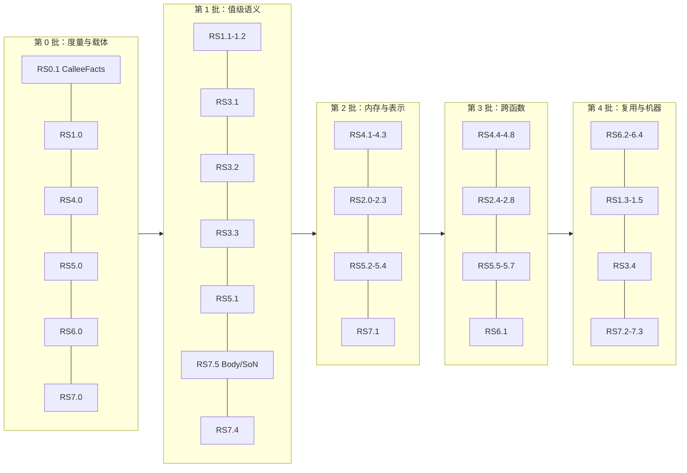

# Rust 语义贯通：MIR → R/S → L → 机器码

日期：2026-11-09。跟踪 issue [#5](https://github.com/Shomvel/kimi-fast-rustc/issues/5)。
源码证据固定在 main `37cea66`；文中 `path:line` 均指该提交。本目录是静态管线分析得到的计划，
没有为它新跑 benchmark，也不预估加速倍数。PoC 范围与六项门槛以 [scope](../scope.md) 与
[metrics](../metrics.md) 为准。

## 问题

kfrc 已保留类型化聚合、逻辑枚举、变体凭据和定义级泛型特化。另一部分 Rust 语义在
MIR → Body → R/S → L → x86 的过程中提前丢失，例如 `*_nonzero` 的零输入契约、unchecked 算术、
存储寿命、`#[cold]`；还有一部分虽然保留，却没有优化消费者，例如分区标签、`Assume`、变体凭据之外的
`PredicateFacts`。本目录为每条事实回答五个问题：来自哪里、在哪个范围有效、由哪个 pass 消费、
到哪个阶段擦除、怎样验证收益与正确性（[facts.md](facts.md)）。

## 分析要点

1. **rustc 的 MIR 优化不参与。** 全部 PoC 运行使用 `-Zmir-opt-level=0`，rustc 的 SROA、GVN、DSE、
   CopyProp、DestinationPropagation 与 MIR 内联都不运行；未取地址的 local 由 kfrc 的 SSA 构造处理，
   取址 local、拷贝链、NRVO 与 move 链由 kfrc 自己负责（RS2、RS4）。
2. **语义在转换器丢失。** 位计数逐位展开（u64 `ctpop` 约 325 个 Body 语句）、unchecked 与普通算术合并、
   `exact_div` 降为 `Div`、`cold_path` 编译为空、Drop 降为普通调用（RS1、RS3、RS7）。
3. **语义保留到 x86 后才丢弃。** `SlotLive`/`SlotDead` 一路保留到指令选择后丢弃，帧布局给每个槽
   独立区域（RS7）；sret 只存在于 x86，L 无法构造到目标（RS2）。
4. **事实已有、消费者缺位。** Local/Const 分区标签只被 verifier 检查；`PredicateFacts` 已实现动态实例检查，
   只用于变体凭据；vtable 槽读已标 Const，没有折叠（RS3、RS4、RS5）。
5. **kfrc 可利用、LLVM 路径难以利用的 Rust 语义：** move 在 SSA 中直接表现为源失效；callee 独占 Indirect
   实参；变体活跃性与不可居留性；“在未分配存储上访问即 UB”使按寿命着色在地址逃逸时同样成立；
   参数 protector 的作用域在内联时可保留为有界作用域。
6. **参数权限的事实来源需要约定。** rustc 在 `-Copt-level=0` 下不计算 `frozen`/`unpin`；
   本计划采用 rustc-O 契约（决定 D1）。

## 文件

| 文件 | 内容 | 首个可独立交付的步骤 |
|---|---|---|
| [facts.md](facts.md) | 事实账本 RF1–RF33；公共载体 RS0.1–RS0.6 | RS0.1 `CalleeFacts` |
| [rs1-integer-intrinsics.md](rs1-integer-intrinsics.md) | 整数 intrinsic 节点、CPU 特性门控 | RS1.1 节点与紧凑回退 |
| [rs2-aggregate-representation.md](rs2-aggregate-representation.md) | LP3 验收、表示决策、私有槽、构造到目标、数组与跨调用需求 | RS2.0 LP3 验收 |
| [rs3-scalar-facts.md](rs3-scalar-facts.md) | 算术标志、有效范围、作用域条件折叠、循环边界检查 | RS3.1 算术标志 |
| [rs4-memory-and-summaries.md](rs4-memory-and-summaries.md) | 位置模型、流敏感逃逸、clobber walker、DSE、调用摘要、copy 拆分 | RS4.1 位置模型 |
| [rs5-borrow-permissions.md](rs5-borrow-permissions.md) | 参数权限、内联作用域、返回摘要、收益内联、去虚化 | RS5.1 权限事实 |
| [rs6-generic-reuse.md](rs6-generic-reuse.md) | R 覆盖、观测读集与身份键、影子模式、共享 | RS6.0 度量 |
| [rs7-storage-drop-cold.md](rs7-storage-drop-cold.md) | 栈槽着色、`DropInPlace`、冷信息 | RS7.0 帧统计 |
| [acceptance.md](acceptance.md) | 证据包、负例编号、issue 关闭条件 | — |

步骤编号 `RSn.k` 是本目录唯一的派工编号；负例为 `N<n>.<k>`，正例为 `P<n>.<k>`。

## 与 LLVM-parity 任务的关系

LP0–LP9（未合入 main 的 LLVM-parity 计划）负责测量、寄存器分配、指令选择、cmov/switch、循环、块布局与
编译时间。本目录与之共享文件时按下表分工：

| LP | 本目录的衔接 |
|---|---|
| LP0/LP8 测量 | RS0.4 的阶段窗口与 LP8 共用口径 |
| LP2 分配器与帧 | RS1.3 新指令、RS2.1 车道传参、RS7.1 槽着色在 LP2 合入后的文件上实现 |
| LP3 叶子 Phi | RS2.0 验收 LP3；RS4.4、RS5.2 改写 `forward.rs` 在 LP3 合入后进行 |
| LP4 操作数与宽度 | RS1.5、RS3.1 的窄宽度消费 |
| LP5 select/switch | RS1.3 的 `cmov`；RS3.2 的 `VariantOf` 范围 |
| LP6 循环 | RS3.4 |
| LP7 块布局 | 消费 RS7.5 的冷信息 |

## 顺序

- 第 0、1 批的步骤不依赖 LP，可以并行派工。
- RS2.0、RS4.4、RS5.2 等待 LP3 合入；RS1.3、RS2.1、RS7.1 等待 LP2 合入；RS3.4 等待 LP6。
- 同一批内只有表中“依赖”列列出的串行关系。

## 已定决定

2026-11-09 用户确认以下方案。修改其中任何一项时，同步修改对应步骤。

| 编号 | 问题 | 决定 | 位置 |
|---|---|---|---|
| D1 | 参数权限的事实来源 | rustc-O 契约，加 `-Copt-level=1` 守卫 | [RS5](rs5-borrow-permissions.md#rustc-1941-的参数事实) |
| D2 | 内联后的权限作用域表示 | 侧表 `PermissionScope`；多效果链落地时再物化为 Reborrow/EndBorrow 节点 | [RS5](rs5-borrow-permissions.md#权限模型) |
| D3 | 持有 vtable 的被调者内联 | v1 克隆只读 Local 对象并改名；长期用内容寻址的全局 vtable 符号 | [RS5](rs5-borrow-permissions.md#去虚化) |
| D4 | 是否增加 `-Zshare-generics=no` 验收臂 | 增加，用于量化 O0 下上游已导出泛型实例的可得性损失 | [RS5](rs5-borrow-permissions.md#分步计划) |
| D5 | 内存依赖的表示 | 查询式，保持单条 effect 链；多链以 RS4.9 的数据为前提 | [RS4](rs4-memory-and-summaries.md#设计决定查询式依赖保持单条-effect-链) |

## 红线

1. **R1 事实上界。** 引用类型、有效范围与 ABI 事实以 rustc 1.94.1 对同一实例生成或可证明的事实为上界
   （D1 的 rustc-O 契约）；其余事实来自 kfrc 自身分析的证明。
2. **R2 落地标准。** 一条事实在账本五项齐全、消费者合入、证据包完整后才算落地。
3. **R3 正确性输入。** 正确性结论来自有定义输入；源 UB 输入只用于确认解释器的 UB 判定。
   涉及别名的用例在 Miri SB 与 TB 下都有定义。
4. **R4 收益口径。** 收益以机器码、编译指令与 runtime 实测为准；节点数与事实数量用于解释。
5. **R5 测量。** 按 [acceptance](acceptance.md#每个步骤的证据包) 规则 1–2。
6. **R6 故障修复。** 按 [acceptance](acceptance.md#每个步骤的证据包) 规则 5。
7. **R7 共享文件。** LP 任务正在修改的文件以其合入 main 后的版本为实现基线。
8. **R8 范围与门槛。** PoC 范围与六项门槛保持 [metrics](../metrics.md) 的冻结值。

## 延后项

| 项 | 方向 | 理由 | 跟踪入口 |
|---|---|---|---|
| `carrying_mul_add`、128 位位运算 | RS1 | 转换器显式 unsupported；先完成 64 位与特性门控 | RS1 延后 |
| `BinOp::Cmp` 的 `setcc` 形式 | RS1 | 与变体穿线的收益需要权衡，等 LP5 | LP5 |
| `Box` 参数权限 | RS5 | rustc 只给 WeakProtector、无 dereferenceable；SB/TB 对 Box 尚未定案 | RS5 延后 |
| 聚合实参中的引用权限 | RS5 | rustc 按 `BackendRepr` 递归，需按语义重新定义 | RS5 延后 |
| 局部重借用作用域 | RS5 | rustc 不使用；SB/TB 结论不同 | 设计文档“明确不做” |
| 闭世界去虚化、堆分配消除 | RS5 | 需要全程序信息 | W07 |
| 多效果链或浮动 load | RS4 | 以 LICM/调度实测为前提 | RS4.9 |
| 捕获点前的部分 SSA | RS4 | 需要在捕获点前物化 store，收益待测 | RS4 风险 |
| R 图发布到 metadata | RS6 | 依赖 RS6.4 | RS6.5 |
| unwind | RS7 | PoC 为 `-Cpanic=abort`；需要 `.eh_frame` 与 landing pad | RS7.6 |

## 状态

步骤状态沿用 [plan/README](../../README.md#任务状态) 的 `planned → in_progress → verified`，
本目录当前全部为 `planned`。开始一个步骤时在对应方向文件的表格中记录负责人、输入 revision 与范围，
完成时附 [acceptance](acceptance.md) 的证据包链接。
